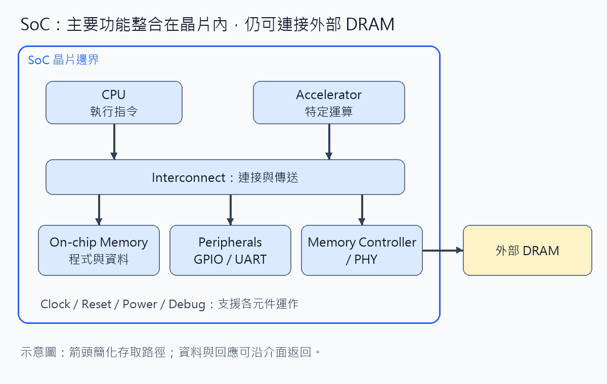
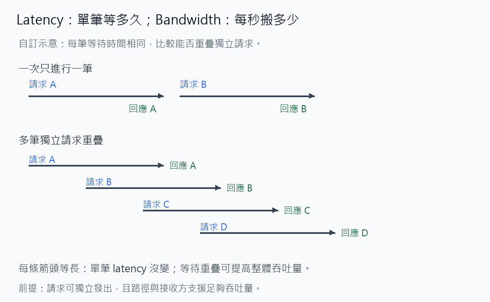
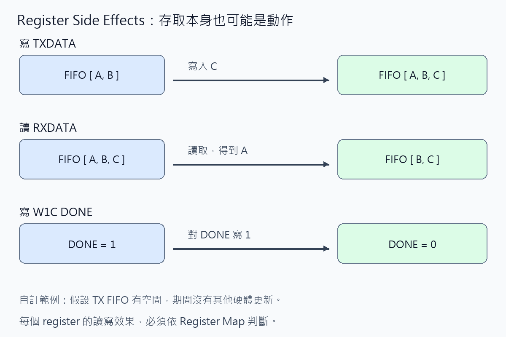
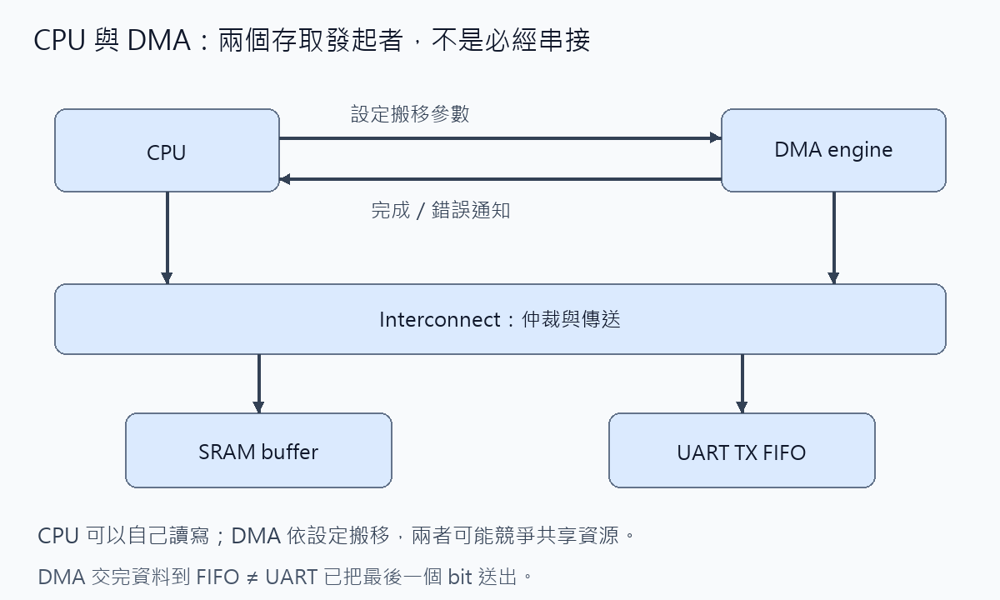
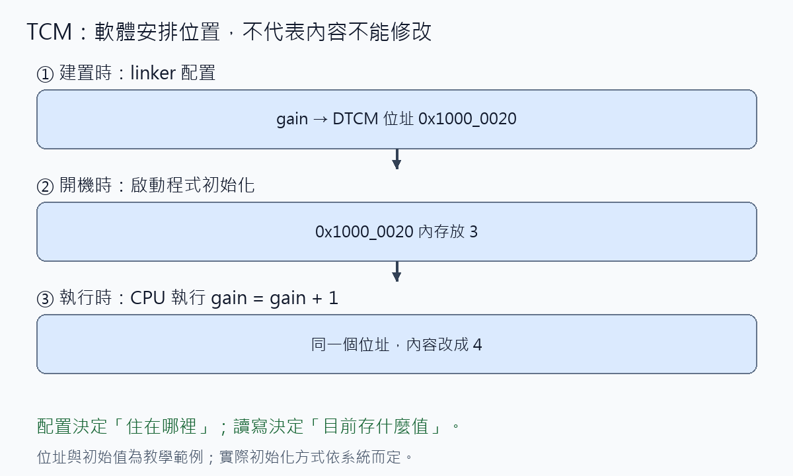
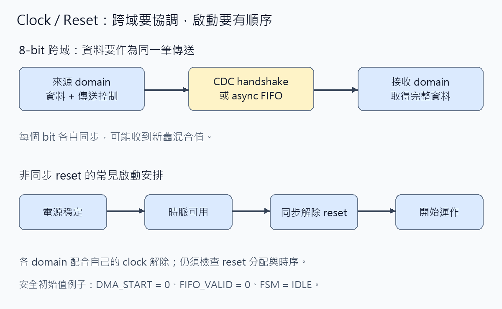

# How a System Works
---

## 1. What Is in an SoC

### Introduction

**SoC (System on Chip)**：將系統的主要功能整合在同一顆晶片上。

* CPU 是其中一個元件，系統還需要儲存、連接、周邊與控制功能。
* **SoC 可以搭配外部記憶體或裝置**，不要求所有元件都在同一顆 die。
* IP：可重複使用、整合到晶片中的功能設計，例如 CPU IP、UART IP。

### Main Blocks

| 分類 | 用途 | 例子 |
| --- | --- | --- |
| Compute | 執行指令與運算 | CPU、Accelerator |
| Memory | 儲存程式與資料 | SRAM、ROM、Cache |
| Interconnect | 連接元件，傳送讀寫請求與回應 | Bus、Crossbar、NoC |
| Peripherals | 周邊功能與對外介面 | GPIO、UART、Timer |
| System services | 支援系統運作 | Clock、Reset、Power、Debug |



> GPIO 是 Peripheral 的一種。Memory Controller 負責控制記憶體存取，本身不等於 DRAM。

### Memory Map & Address Decoding

**Memory Map**：定義各元件對應的位址範圍。

**Address decoder**：依照硬體實作的位址配置，辨識請求的目標。

教學範例（不是固定標準）：

| 位址範圍 | 目標 |
| --- | --- |
| `0x2000_0000`～`0x2000_3FFF` | SRAM |
| `0x4000_0000`～`0x4000_0FFF` | GPIO |

假設 `0x4000_0000` 是 GPIO output register，bit 0 控制一個輸出腳位：


1. CPU 發出 write request，帶有 address 與 data。
2. Interconnect 解碼 address，將請求送到 GPIO。
3. GPIO 更新 output register，bit 0 變成 1。
4. 對應腳位輸出高電位（假設已設定為一般輸出模式）。

**這次操作不會寫入 SRAM。** 位址可以對應 memory，也可以對應 peripheral register；後者是 MMIO 的核心概念。

### System Performance & Area

* 存取時間與路徑、元件回應速度及等待情況有關。
* **Polling（輪詢）**：CPU 反覆讀取狀態，檢查裝置是否就緒。
* CPU 算得更快，不代表 UART 傳輸也變快；應先找出整體工作的瓶頸。
* 記憶體容量、暫存器與運算電路的位元寬度都會影響面積。

### Quiz Review

1. **元件分類**：Memory、GPIO、Interconnect 的方向正確；GPIO 屬於 Peripherals。補上用途：儲存資料／控制或讀取腳位／傳送元件間的交易。
2. **GPIO write**：使用 decoder、且不改變 SRAM，回答正確。最後一步應說明「更新 GPIO output register，進而改變腳位」，不只重述寫入位址。
3. **位址的意義**：回答正確。更精確地說，位址對應到 memory location 或 peripheral 的特定 register。
4. **等待 UART**：瓶頸判斷正確。名稱是 **Polling**，不是 rolling。
5. **外部 DRAM**：原先回答「不能稱為 SoC」需要修正。**仍然是 SoC**；主要系統功能整合在晶片內，不排除外接 DRAM。

外部 DRAM 的簡化存取路徑：

```text
CPU → Interconnect → Memory Controller / PHY → 晶片接腳與板上連線 → DRAM
```

> 此處省略 Cache 等細節。PHY 負責實體介面訊號，本章先知道它位於對外記憶體介面即可。

### 本章主線

SoC 的元件分工 → Interconnect 連接 → Memory Map 配置 → Address decoding 選擇目標 → 執行讀寫。

### Source

* [ChipVerify — What Is in an SoC](https://chipverify.com/soc-design/what-is-in-an-soc)
* 圖片為本筆記重新繪製的教學示意圖；位址範例與測驗訂正依本次教學整理。

## 2. Buses and Transactions

### Bus & Transaction

* **Bus**：元件間的通訊介面，包含訊號與使用規則（Protocol）。
* **Transaction**：從請求到回應的一次完整讀取或寫入。
* **Manager / Master**：發起交易；**Subordinate / Slave**：接收請求並回應。
* 角色依介面行為決定：CPU 設定 DMA 時，DMA 是 Slave；DMA 主動讀取 SRAM 時，DMA 是 Master。

### AXI Channels


| 操作 | Channel | 方向 | 內容 |
| --- | --- | --- | --- |
| Write | AW | Master → Slave | Write address |
| Write | W | Master → Slave | Write data、WSTRB |
| Write | B | Slave → Master | Write response（BRESP） |
| Read | AR | Master → Slave | Read address |
| Read | R | Slave → Master | Read data、Read response（RRESP） |

**讀取用 AR、R；寫入用 AW、W、B。** 讀取不使用 B。

WSTRB 指定哪些 byte 要寫入；五通道是 AXI 的設計，不是所有 bus 的共同規定。

### VALID / READY Handshake

* 發送方控制 VALID：資訊有效。
* 接收方控制 READY：可以接收。
* **上升緣取樣到 VALID = 1 且 READY = 1，才完成一次傳送。**
* 尚未握手時，必須保持 VALID 與該通道的 payload 不變。例如 WDATA、WSTRB，或 B 通道的 BRESP。
* 接收方暫時不接收，讓發送方等待，稱為 Backpressure。
* 發送方不能等待 READY 才提出 VALID，避免雙方互等。

### Why Separate Channels?

**目的：各部分獨立準備與接收，減少不必要等待，支援緩衝與流水線。**

例如位址先準備好，可以先接收位址，再等資料；接收方需保存已接收的資訊並記錄狀態。

* AW、W 可以同一拍握手，也可以不同拍握手。
* 簡單接收方可以等 AWVALID、WVALID 到齊再一起接收，但仍須遵守 AXI 握手規則。
* **不能假設所有 AXI 元件都會讓 AW、W 同時握手。**
* 通道獨立不代表沒有依賴：AXI4-Lite 的 B 回應必須在該筆 AW、W 都被接收之後產生。

### Independent Completion


上圖是一筆 AXI4-Lite write，沒有下一筆交易：

1. T1：AW 握手，位址已接收；W 未握手。
2. T2：AWVALID 可降低；WVALID 與資料必須保持。
3. T3：W 握手，資料被接收。
4. T4：BVALID = 1、BREADY = 0，回應仍未被接收。
5. T5：B 握手，Master 接收並檢查 BRESP；此例為 OKAY。

**各通道完成後各自更新，不能等 W 握手才把 AWVALID、WVALID 一起降低。**

若 AW 已完成卻繼續維持 AWVALID，且後續上升緣 AWREADY 仍為 1，就會再接受一筆 AW。只有真的要送下一筆位址，才能把這當成新的傳送。

### Responses & Errors

* AW / W 握手：代表位址／資料已被接收，不保證操作成功。
* B 握手：Master 接收回應，還要檢查 BRESP 是成功或錯誤。
* 找不到目標或目標無法處理時，也應回傳錯誤，避免發起方無限等待。
* **BVALID = 1、BREADY = 0 時，Slave 必須維持 BVALID 與 BRESP。** 此時回應已提出，只是尚未被接收。

### Quiz Review

1. **角色判斷：正確。** CPU → DMA：CPU 是 Master；DMA → SRAM：DMA 是 Master。
2. **讀取通道：需修正。** 回答的 AW、W 是寫入；正確是 AR 傳位址，R 回傳資料與狀態，不使用 B。
3. **握手時序：正確。** T3 接收；T2 尚未握手，不能更換資料。
4. **獨立判斷：方向正確。** 原設計在 AW 完成、W 尚未完成時撤掉 WVALID，會讓資料未被接收。改成等 W 才一起撤掉也不對，可能重複送出 AW；應各自判斷握手、各自更新 VALID。
5. **回應：前兩項正確，原因補充。** 操作失敗要回傳 B 錯誤；BVALID 不能在未握手時撤掉。AW、W 只代表接收請求，是否成功要看接收到的 BRESP。

### Source

* [ChipVerify — Buses and Transactions](https://chipverify.com/soc-design/buses-and-transactions)
* [Arm — AMBA AXI and ACE Protocol Specification（握手與通道依賴）](https://developer.arm.com/-/media/Arm%20Developer%20Community/PDF/IHI0022H_amba_axi_protocol_spec.pdf)
* 圖片與時序範例為本筆記自行繪製；本節以 AXI4-Lite 單筆讀寫為主。

## 3. Latency and Bandwidth

### Introduction

| 名稱 | 意義 | 單位 |
| --- | --- | --- |
| Latency | 一次請求從發出到取得結果的時間 | cycles、ns |
| Bandwidth | 單位時間能搬移的資料量 | Bytes/s、MB/s、GB/s |

**一筆等多久，與每秒搬多少，是不同問題。** 比較 latency 時，不能只比較 cycle 數，還要看 clock frequency。

### Calculation

```text
Clock period = 1 / Clock frequency
Latency = cycles × Clock period
```

測驗範例：100 MHz、每次讀 4 Bytes、每次需 5 cycles。

```text
Clock period = 10 ns
Latency = 5 × 10 ns = 50 ns

一次只允許一筆交易，完成後立即發出下一筆，忽略額外空檔：
Bandwidth = 4 Bytes / 50 ns
          = 80,000,000 Bytes/s = 80 MB/s
```

> 此處 1 MB = 1,000,000 Bytes；1 Byte = 8 bits。上述 bandwidth 公式有「不能重疊交易」的前提。

### Overlap & Burst



* **Outstanding transaction**：已發出、尚未完成的交易。
* 多筆獨立交易可重疊等待，單筆 latency 不變，整體 bandwidth 仍可能增加。
* 前提：請求彼此獨立，且發送方、接收方與路徑均支援所需吞吐量。
* **Burst**：一筆位址請求搭配多筆資料傳送，分攤位址與控制開銷。
* **Peak bandwidth** 是理想能力；實際達成值受等待、競爭與軟體行為影響。

### Find the Bottleneck

| 類型 | 現象 | 改善方向 |
| --- | --- | --- |
| Latency-bound | 等待單筆資料才能繼續 | 降低延遲；可獨立的請求才適合重疊 |
| Bandwidth-bound | 路徑持續忙碌，資料仍搬不完 | 增加傳輸能力或減少資料量 |
| Device-bound | 終端裝置比前面的路徑慢 | 改善裝置速度，或讓 CPU 等待時做別的工作 |

若下一筆位址依賴上一筆資料，每次只讀 4 Bytes，則 bus 從 32-bit 加寬至 64-bit、但 latency 不變，不能保證加速。

### Quiz Review

1. **Latency 與公式正確**：回答 50 ns、4 B / 50 ns。補上題目要求的換算結果：**80 MB/s**。
2. **瓶頸判斷正確**：Latency-bound，不一定快兩倍。原因是請求有資料依賴，且每次需要的資料量與等待時間沒有改變。

### Source

* [ChipVerify — Latency and Bandwidth](https://chipverify.com/soc-design/latency-and-bandwidth)
* 計算與圖解為自訂教學範例，不代表特定硬體的量測結果。

## 4. Memory-Mapped I/O and Registers

### MMIO & Register Map

**MMIO (Memory-Mapped I/O)**：將周邊暫存器配置到位址空間，CPU 用 load / store 操作。

* Device register 位於周邊內，不是 CPU 的通用暫存器。
* Memory Map 定義各元件的位址範圍。
* Register Map 定義元件內每個 register 的 offset、bit fields、access type、reset value 與副作用。

```text
Register address = Base address + Offset
```

本章自訂 UART 範例（位址與欄位依設計而異）：

| Base | Offset | Register | 用途 |
| --- | --- | --- | --- |
| 0x5000_0000 | 0x00 | CTRL | 控制設定 |
| 0x5000_0000 | 0x04 | STATUS | 狀態；完整位址 0x5000_0004 |
| 0x5000_0000 | 0x08 | TXDATA | 寫入待傳送資料 |

### Bit Fields & Ownership

本例 STATUS：bit 0 = FULL、bit 1 = BUSY，兩者都是 RO。

* FULL = 1：傳送 FIFO 已滿。
* BUSY = 1：仍有資料等待傳送或正在傳送。
* **STATUS = 0b10：還能加入資料，但尚未全部傳完。**

```c
full = status & 0x1;
busy = (status >> 1) & 0x1;
```

**軟體透過 CPU 執行存取，所以軟體與 CPU 通常不是兩個獨立的寫入來源。**

| 欄位或暫存器 | 誰影響它 | CPU 的操作 |
| --- | --- | --- |
| CTRL.ENABLE | 軟體經 CPU 設定 | 寫入以啟用功能 |
| STATUS.FULL | FIFO 控制邏輯 | 讀取，不能寫 0 來騰出空間 |
| STATUS.BUSY | UART 傳送控制邏輯 | 讀取工作狀態 |
| TXDATA | 軟體提供資料，硬體接收 | 寫入待傳送資料 |

同一個 register 的不同欄位可以有不同權限。某些狀態不需獨立 flip-flop，例如 FULL 可以由「資料數量 == FIFO 容量」產生。

### Access Types & Side Effects

| 類型 | 軟體操作規則 |
| --- | --- |
| RO | 只能讀；寫入的處理依規格 |
| WO | 只能寫；不能假設讀回最後寫入值 |
| RW | 可讀可寫 |
| W1C | 寫 1 清除對應 bit；寫 0 不清除 |

**Side effect：一次存取除了傳遞數值，還觸發動作或改變裝置狀態。**



1. **寫 TXDATA → 加入佇列**：有空間時連寫兩個 C，會加入兩筆 C，不只是保留最後一個值。重複執行一次交易可能造成多送一個字元。
2. **讀 RXDATA → 取出資料**：若規格定義讀取會 pop FIFO，第一次讀到 A 並移除 A，下一次就讀到 B。不能為了確認而隨意多讀。
3. **寫 W1C → 清除事件**：硬體完成時把 DONE 設為 1；軟體處理後對該 bit 寫 1，DONE 清為 0。

FULL / BUSY 通常描述當下狀態；DONE 事件旗標可以記住發生過的事件，直到軟體確認。不是所有讀取都有副作用，必須依 Register Map 判斷。

> 若硬體設置與軟體清除同時發生，優先順序也必須由規格定義。

### Software Access

* **volatile**：讓編譯器依其 volatile 存取規則保留裝置存取，避免把輪詢簡化成只讀一次。實際平台可能提供專用 MMIO accessor。
* volatile 不等於硬體 memory barrier，也不保證 atomicity。
* 存取寬度、對齊、保留位元與操作順序都應依裝置規格。

對一般 RW register 設定 bit 3：

```c
reg = reg | (1u << 3);
```

這是 **Read-Modify-Write**：讀舊值 → 修改 → 寫回整個值。若中間有中斷程式改動其他 bit，最後寫回可能覆蓋它的修改。

專用 SET / CLEAR register 可讓軟體直接修改指定 bit，避免這類讀後寫回問題。不能把一般 RW 的操作方式直接套用到 W1C 等特殊欄位。

### Quiz Review

1. **位址與權限判斷正確**：STATUS = 0x5000_0004；0b10 表示有空間、仍忙碌，所以可以加入資料，但尚未全部傳送完成。CPU 不能直接改寫本例 RO 的 FULL / BUSY。
2. **副作用判斷正確**：連讀兩次得到 A、B，FIFO 剩 C；對 DONE 寫 1 後清為 0（假設期間沒有其他硬體更新）。

### Source

* [ChipVerify — Memory-Mapped I/O and Registers](https://chipverify.com/soc-design/memory-mapped-io)
* UART 位址、圖解與副作用情境為本次教學範例，實際存取行為應依各裝置規格。

## 5. Polling, Interrupts and DMA

### Who Waits? Who Moves Data?

| 方式 | 如何知道要處理？ | 誰搬資料？ | 適合情境 |
| --- | --- | --- | --- |
| Polling | CPU 主動讀狀態 | 通常 CPU | 很短的等待、簡單初始化 |
| Interrupt | 裝置提出 IRQ | 通常仍是 CPU | 按鍵等偶發事件 |
| DMA | 依設定與裝置握手運作 | DMA engine | 大量或連續資料 |

**Interrupt 是通知機制，DMA 是搬移機制，可以一起使用。**

Polling 可以是連續忙等，也可以定期檢查；前者消耗 CPU 時間，後者的檢查間隔影響事件發現延遲。

### Interrupt Flow

```text
裝置事件 → IRQ → CPU 執行 ISR → 處理中斷來源 → 返回原程式
```

* ISR = Interrupt Service Routine。
* CPU 在事件之間可做其他工作或進入適當的低功耗狀態。
* 進出 ISR、保存狀態都需時間；遮蔽與優先級也會影響回應時間。
* 必須依裝置規格處理中斷來源，避免同一請求持續觸發。

### DMA Engine



CPU 通常設定 source、destination、length、control，再啟動 DMA。DMA 自己發起 bus transaction，完成或出錯後可用 interrupt 通知 CPU，也可由 CPU 輪詢其狀態。

* DMA 常是 CPU 之外的 IP，也可整合在周邊或子系統中；不代表獨立晶片。
* **DMA 不是 CPU 存取記憶體的必經關卡。CPU 仍能自己執行 load / store。**
* CPU 與 DMA 可能競爭同一記憶體或互連資源，並行不代表完全沒有等待。
* DMA 工作期間，buffer 的使用要遵守所有權與同步規則。
* 若 CPU 有 Cache、DMA 不參與硬體一致性機制，還需確保雙方看到最新資料。
* DMA 不會自動提高 UART 接腳的傳送速率。

**DMA 將最後一筆資料交給 UART FIFO，不等於 UART 已把最後一個 bit 送出。** 真正送完要看裝置定義的傳送完成狀態。

### Quiz Review

1. **選擇正確**：偶發按鍵用 Interrupt，避免持續檢查；大量音訊用 DMA，減少 CPU 逐筆搬移。補充：兩者可結合，DMA 搬移完成後用 Interrupt 通知 CPU。
2. **分工正確**：DMA 工作時 CPU 仍可存取其他允許的記憶體。DMA 完成送入 FIFO，不代表 UART 的序列傳送已完成。

### Source

* [ChipVerify — Polling, Interrupts and DMA](https://chipverify.com/soc-design/polling-interrupts-and-dma)
* [Microchip — What is DMA?](https://onlinedocs.microchip.com/oxy/GUID-75C1A2B2-9CEC-425F-A886-10871EA17F75-en-US-1/GUID-2FE5A182-F3F5-46C0-8AD3-32184D642B38.html)

## 6. Memories in a System

### Memory Types

| 類型 | 斷電保留？ | 特性與用途 |
| --- | --- | --- |
| Register | 通常不保留 | 小量工作值、控制與狀態 |
| SRAM | 不保留 | 不需 refresh；常用於片上 Cache、TCM、Buffer |
| DRAM | 不保留 | 密度高、需 refresh；常作大容量主記憶體 |
| Mask ROM | 保留 | 製造時固定內容，常用於初始開機程式 |
| Flash | 保留 | 可重新編程，擦寫較慢且有壽命限制 |

**SRAM 的 Static 不代表斷電保留，只代表供電正常時不需像 DRAM 一樣 refresh。**

volatile memory（揮發性記憶體）與 C 的 `volatile` 關鍵字是不同概念。

### SRAM, Data Memory, Cache, TCM

這些名稱不是互斥的分類：

| 名稱 | 描述什麼？ |
| --- | --- |
| Data memory | 用來存放資料的用途 |
| SRAM / DRAM | 儲存技術 |
| TCM | 與 CPU 緊密連接、具有明確位址配置的記憶體組織 |
| Data Cache | 由硬體管理資料副本以加快存取的機制 |

因此可以有「用 SRAM 實作的 DTCM，用來存放資料與 stack」。部分處理器區分 ITCM（指令）與 DTCM（資料），實際組織依設計。

| | Cache | TCM |
| --- | --- | --- |
| 放什麼 | Cache controller 硬體自動管理副本與替換 | 軟體配置、初始化或執行時複製 |
| 位址 | CPU 使用原資料位址，硬體判斷 hit / miss | 配置在 TCM 對應的位址區域 |
| 時間特性 | 受 hit / miss 與下一層路徑影響 | 避免 cache miss，通常較容易界定延遲 |

TCM 通常透過 CPU 專用介面存取。**TCM 不是唯讀記憶體，CPU 可以修改內容**，除非另設保護限制。DMA 能否存取它要看 SoC 互連與權限。

### TCM：位置與內容是兩件事



自訂範例：`gain` 配置在 DTCM 的 `0x1000_0020`。

1. **建置時**：程式配置與 linker 決定 gain 放在哪個位址。
2. **開機時**：啟動程式依映像配置初始化，例如把初始值 3 複製到該處；其他區域可能清零。
3. **執行時**：CPU 執行 `gain = gain + 1`，讀出 3、計算後寫回 4。

**gain 的位置不變，但內容由 3 變 4。** 軟體管理也可以包含執行中的程式主動把資料複製進 TCM，不限於開機。

### Predictability

指的是**存取時間可預測**，不是資料值可預測。

假設某控制工作必須在 100 cycles 內完成：平均很快、偶爾因 cache miss 等很久，仍可能錯過期限。若每次延遲固定或有可靠的最壞上限，較容易驗證是否準時。

**TCM 不受 Cache 替換造成的 hit / miss 變動影響，但不保證任何系統下永遠固定一個 cycle。** 等待週期、仲裁與錯誤保護等仍需依規格分析。

### Organization & Placement

```text
容量 = Depth × Width
例：2,048 words × 32 bits = 65,536 bits = 8,192 Bytes = 8 KiB
```

* Depth：有幾個 word；Width：每個 word 幾個 bit。
* Port：可用的存取介面；單埠 SRAM 通常每週期做一次讀或寫，更多 port 增加成本。
* 大型片上儲存通常用 memory macro，不是全用一般 flip-flop 拼出來。
* 選擇位置時看：斷電保留需求、容量、延遲、時間上限，以及哪些元件需要存取。
* 固定初始開機碼可放 Mask ROM；可更新韌體可放 Flash；時間敏感資料可考慮 TCM；大量運行資料可考慮 DRAM。
* **CPU 看得到，不保證 DMA 看得到。** 共用 buffer 必須放在兩者都能存取的區域。

### Error Protection

* Parity：偵測某些位元錯誤，一般不提供錯誤定位與修正。
* ECC：加入檢查資訊，能力依編碼而異。
* 常見 SECDED：修正單 bit 錯誤、偵測雙 bit 錯誤；需額外儲存與邏輯。

### Quiz Review

1. **可修改的判斷正確，配置觀念補充**：linker 配置決定「變數住在哪個位址」；CPU 寫入決定「該位址目前存什麼值」。TCM 的 gain 可以由 3 改為 4。
2. **可預測性方向正確，措辭修正**：指存取時間。TCM 避免 cache miss，通常較容易保證時間上限，不是一概保證完全固定。Cache 副本由 **Cache controller 硬體**依策略填入、更新與替換。

### Source

* [ChipVerify — Memories in a System](https://chipverify.com/soc-design/memories-in-a-system)
* [Microchip — Cache Memory vs TCM](https://onlinedocs.microchip.com/oxy/GUID-C88935CB-DA64-4DAF-944C-E314A1ACB890-en-US-1/GUID-45F2B8DB-0E69-447D-91BE-22866EAA9139.html)
* [AMD — Tightly-coupled Memories](https://docs.amd.com/r/en-US/am011-versal-acap-trm/Tightly-coupled-Memories)
* 圖片、gain 位址及容量計算為自訂教學範例。

## 7. Clocks and Resets in a System

### Clock & Reset

* Clock：決定暫存器何時取樣、更新狀態。
* Reset：讓必要的控制狀態回到已知起點，不要求所有資料暫存器都 reset。
* 例如未初始化的資料可以由 valid = 0 保護，保證寫入後才使用。
* Clock 來源可經 PLL、分頻、clock gating 與 clock tree 分送至各區域。
* 不同時脈需求形成不同 Clock Domain；跨域訊號需依兩端時序關係分析。

### CDC — Clock Domain Crossing

沒有可保證時序關係的訊號，可能在接收端的 setup / hold window 內變動，使 FF 進入 metastability。

* 兩級同步器提供更多穩定時間，降低亞穩態傳播機率，不是保證風險為零。
* 適合的單 bit 狀態可使用兩級同步器；短 pulse 仍可能漏接。
* **多 bit 各自同步，不能保證資料一致性。** 各 bit 可能在不同拍被接收，拼出新舊混合值。
* 多 bit 資料常用跨域 handshake（資料保持穩定直到協定允許更新）或 asynchronous FIFO。



### Reset Sequence

```text
電源穩定 → 時脈可用 → 依依賴順序解除各區域 reset → CPU 開始取指令
```

對採非同步 reset 的電路，常見設計是 **asynchronous assertion、synchronous deassertion**。

* Assertion：非同步進入 reset。
* Deassertion：配合各 domain 的 clock 安全解除，滿足 recovery / removal 等時序要求。
* 不安全的解除可能讓不同 FF 在不同拍恢復，或產生亞穩態，使 FSM 等控制狀態不一致。
* 同步器之外，reset 的分配與實體時序仍需檢查。

### Safe Reset Values

| 狀態 | 初始值例子 | 原因 |
| --- | --- | --- |
| DMA_START | 0 | 軟體尚未設定來源、目的地與長度前不要啟動 |
| FIFO_VALID | 0 | 不把未知或舊內容當有效資料 |
| FSM_STATE | IDLE | 從已知流程開始 |

若 DMA_START = 1，可能在未完成設定時發起交易，造成非預期讀寫、錯誤回應或資料破壞，實際結果依其他控制條件而定。

部分 reset 還需考慮進行中的交易：只重置交易一方，另一方可能永遠等不到回應。需依架構排空、終止或以其他受控方式處理交易。

### Quiz Review

1. **完整正確**：8-bit 各自接兩級 FF 無法保證同一筆資料的一致性；使用適當 CDC handshake 或 async FIFO。
2. **方向正確**：非同步解除可能造成各 FF 不同拍恢復。補充：須考慮 recovery / removal 與亞穩態；未設定就啟動 DMA，具體風險是非預期位址／長度的交易與資料破壞。

### Source

* [ChipVerify — Clocks and Resets in a System](https://chipverify.com/soc-design/clocks-and-resets-in-a-system)
* 圖解與 DMA 初始值情境為教學整理；實際同步器、reset 順序與時序限制依系統規格。
