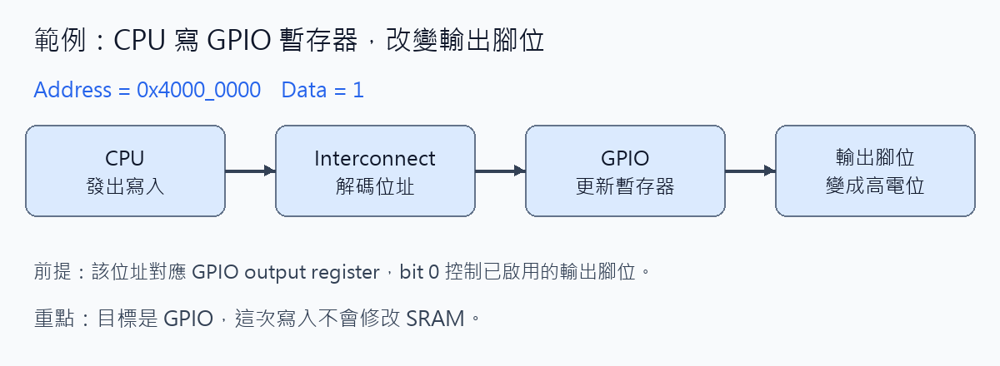

# How a System Works

> 第一單元：逐章學習，完成小測驗與訂正後，將重點整理到本筆記。

### 學習與更新方式

1. 中文重點講解，搭配必要的圖解。
2. 讀完章節後進行小測驗。
3. 訂正後補充本單元筆記與圖片。
4. 以 GitHub 保存最新版本，在 HackMD 使用 Pull from GitHub 取得更新。

---

## 1. What Is in an SoC

### Introduction

**SoC (System on Chip)**：將系統的主要功能整合在同一顆晶片上。

* CPU 是其中一個元件，系統還需要儲存、連接、周邊與控制功能。
* **SoC 可以搭配外部記憶體或裝置**，不要求所有元件都在同一顆 die。
* IP：可重複使用、整合到晶片中的功能設計，例如 CPU IP、UART IP。

### Main Blocks

| 分類 | 用途 | 例子 |
| --- | --- | --- |
| Compute | 執行指令與運算 | CPU、Accelerator |
| Memory | 儲存程式與資料 | SRAM、ROM、Cache |
| Interconnect | 連接元件，傳送讀寫請求與回應 | Bus、Crossbar、NoC |
| Peripherals | 周邊功能與對外介面 | GPIO、UART、Timer |
| System services | 支援系統運作 | Clock、Reset、Power、Debug |


> GPIO 是 Peripheral 的一種。Memory Controller 負責控制記憶體存取，本身不等於 DRAM。

### Memory Map & Address Decoding

**Memory Map**：定義各元件對應的位址範圍。

**Address decoder**：依照硬體實作的位址配置，辨識請求的目標。

教學範例（不是固定標準）：

| 位址範圍 | 目標 |
| --- | --- |
| `0x2000_0000`～`0x2000_3FFF` | SRAM |
| `0x4000_0000`～`0x4000_0FFF` | GPIO |

假設 `0x4000_0000` 是 GPIO output register，bit 0 控制一個輸出腳位：



1. CPU 發出 write request，帶有 address 與 data。
2. Interconnect 解碼 address，將請求送到 GPIO。
3. GPIO 更新 output register，bit 0 變成 1。
4. 對應腳位輸出高電位（假設已設定為一般輸出模式）。

**這次操作不會寫入 SRAM。** 位址可以對應 memory，也可以對應 peripheral register；後者是 MMIO 的核心概念。

### System Performance & Area

* 存取時間與路徑、元件回應速度及等待情況有關。
* **Polling（輪詢）**：CPU 反覆讀取狀態，檢查裝置是否就緒。
* CPU 算得更快，不代表 UART 傳輸也變快；應先找出整體工作的瓶頸。
* 記憶體容量、暫存器與運算電路的位元寬度都會影響面積。

### Quiz Review

1. **元件分類**：Memory、GPIO、Interconnect 的方向正確；GPIO 屬於 Peripherals。補上用途：儲存資料／控制或讀取腳位／傳送元件間的交易。
2. **GPIO write**：使用 decoder、且不改變 SRAM，回答正確。最後一步應說明「更新 GPIO output register，進而改變腳位」，不只重述寫入位址。
3. **位址的意義**：回答正確。更精確地說，位址對應到 memory location 或 peripheral 的特定 register。
4. **等待 UART**：瓶頸判斷正確。名稱是 **Polling**，不是 rolling。
5. **外部 DRAM**：原先回答「不能稱為 SoC」需要修正。**仍然是 SoC**；主要系統功能整合在晶片內，不排除外接 DRAM。

外部 DRAM 的簡化存取路徑：

```text
CPU → Interconnect → Memory Controller / PHY → 晶片接腳與板上連線 → DRAM
```

> 此處省略 Cache 等細節。PHY 負責實體介面訊號，本章先知道它位於對外記憶體介面即可。

### 本章主線

SoC 的元件分工 → Interconnect 連接 → Memory Map 配置 → Address decoding 選擇目標 → 執行讀寫。

### Source

* [ChipVerify — What Is in an SoC](https://chipverify.com/soc-design/what-is-in-an-soc)
* 圖片為本筆記重新繪製的教學示意圖；位址範例與測驗訂正依本次教學整理。

## 2. Buses and Transactions

## 3. Latency and Bandwidth

## 4. Memory-Mapped I/O and Registers

## 5. Polling, Interrupts and DMA

## 6. Memories in a System

## 7. Clocks and Resets in a System
