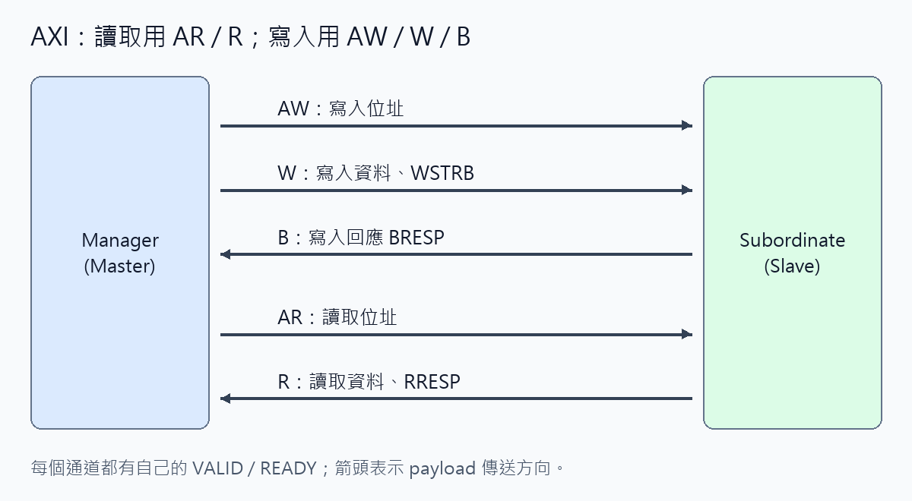
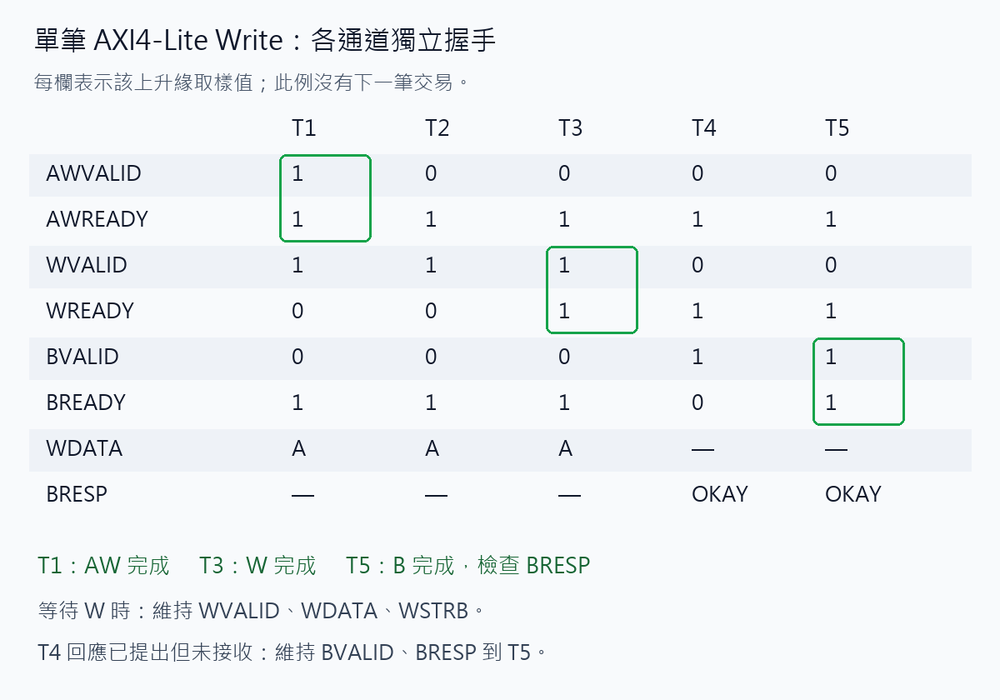

# How a System Works

> 第一單元：逐章學習，完成小測驗與訂正後，將重點整理到本筆記。

### 學習與更新方式

1. 中文重點講解，搭配必要的圖解。
2. 讀完章節後進行小測驗。
3. 訂正後補充本單元筆記與圖片。
4. 以 GitHub 保存最新版本，在 HackMD 使用 Pull from GitHub 取得更新。

---

## 1. What Is in an SoC

### Introduction

**SoC (System on Chip)**：將系統的主要功能整合在同一顆晶片上。

* CPU 是其中一個元件，系統還需要儲存、連接、周邊與控制功能。
* **SoC 可以搭配外部記憶體或裝置**，不要求所有元件都在同一顆 die。
* IP：可重複使用、整合到晶片中的功能設計，例如 CPU IP、UART IP。

### Main Blocks

| 分類 | 用途 | 例子 |
| --- | --- | --- |
| Compute | 執行指令與運算 | CPU、Accelerator |
| Memory | 儲存程式與資料 | SRAM、ROM、Cache |
| Interconnect | 連接元件，傳送讀寫請求與回應 | Bus、Crossbar、NoC |
| Peripherals | 周邊功能與對外介面 | GPIO、UART、Timer |
| System services | 支援系統運作 | Clock、Reset、Power、Debug |


> GPIO 是 Peripheral 的一種。Memory Controller 負責控制記憶體存取，本身不等於 DRAM。

### Memory Map & Address Decoding

**Memory Map**：定義各元件對應的位址範圍。

**Address decoder**：依照硬體實作的位址配置，辨識請求的目標。

教學範例（不是固定標準）：

| 位址範圍 | 目標 |
| --- | --- |
| `0x2000_0000`～`0x2000_3FFF` | SRAM |
| `0x4000_0000`～`0x4000_0FFF` | GPIO |

假設 `0x4000_0000` 是 GPIO output register，bit 0 控制一個輸出腳位：


1. CPU 發出 write request，帶有 address 與 data。
2. Interconnect 解碼 address，將請求送到 GPIO。
3. GPIO 更新 output register，bit 0 變成 1。
4. 對應腳位輸出高電位（假設已設定為一般輸出模式）。

**這次操作不會寫入 SRAM。** 位址可以對應 memory，也可以對應 peripheral register；後者是 MMIO 的核心概念。

### System Performance & Area

* 存取時間與路徑、元件回應速度及等待情況有關。
* **Polling（輪詢）**：CPU 反覆讀取狀態，檢查裝置是否就緒。
* CPU 算得更快，不代表 UART 傳輸也變快；應先找出整體工作的瓶頸。
* 記憶體容量、暫存器與運算電路的位元寬度都會影響面積。

### Quiz Review

1. **元件分類**：Memory、GPIO、Interconnect 的方向正確；GPIO 屬於 Peripherals。補上用途：儲存資料／控制或讀取腳位／傳送元件間的交易。
2. **GPIO write**：使用 decoder、且不改變 SRAM，回答正確。最後一步應說明「更新 GPIO output register，進而改變腳位」，不只重述寫入位址。
3. **位址的意義**：回答正確。更精確地說，位址對應到 memory location 或 peripheral 的特定 register。
4. **等待 UART**：瓶頸判斷正確。名稱是 **Polling**，不是 rolling。
5. **外部 DRAM**：原先回答「不能稱為 SoC」需要修正。**仍然是 SoC**；主要系統功能整合在晶片內，不排除外接 DRAM。

外部 DRAM 的簡化存取路徑：

```text
CPU → Interconnect → Memory Controller / PHY → 晶片接腳與板上連線 → DRAM
```

> 此處省略 Cache 等細節。PHY 負責實體介面訊號，本章先知道它位於對外記憶體介面即可。

### 本章主線

SoC 的元件分工 → Interconnect 連接 → Memory Map 配置 → Address decoding 選擇目標 → 執行讀寫。

### Source

* [ChipVerify — What Is in an SoC](https://chipverify.com/soc-design/what-is-in-an-soc)
* 圖片為本筆記重新繪製的教學示意圖；位址範例與測驗訂正依本次教學整理。

## 2. Buses and Transactions

### Bus & Transaction

* **Bus**：元件間的通訊介面，包含訊號與使用規則（Protocol）。
* **Transaction**：從請求到回應的一次完整讀取或寫入。
* **Manager / Master**：發起交易；**Subordinate / Slave**：接收請求並回應。
* 角色依介面行為決定：CPU 設定 DMA 時，DMA 是 Slave；DMA 主動讀取 SRAM 時，DMA 是 Master。

### AXI Channels



| 操作 | Channel | 方向 | 內容 |
| --- | --- | --- | --- |
| Write | AW | Master → Slave | Write address |
| Write | W | Master → Slave | Write data、WSTRB |
| Write | B | Slave → Master | Write response（BRESP） |
| Read | AR | Master → Slave | Read address |
| Read | R | Slave → Master | Read data、Read response（RRESP） |

**讀取用 AR、R；寫入用 AW、W、B。** 讀取不使用 B。

WSTRB 指定哪些 byte 要寫入；五通道是 AXI 的設計，不是所有 bus 的共同規定。

### VALID / READY Handshake

* 發送方控制 VALID：資訊有效。
* 接收方控制 READY：可以接收。
* **上升緣取樣到 VALID = 1 且 READY = 1，才完成一次傳送。**
* 尚未握手時，必須保持 VALID 與該通道的 payload 不變。例如 WDATA、WSTRB，或 B 通道的 BRESP。
* 接收方暫時不接收，讓發送方等待，稱為 Backpressure。
* 發送方不能等待 READY 才提出 VALID，避免雙方互等。

### Why Separate Channels?

**目的：各部分獨立準備與接收，減少不必要等待，支援緩衝與流水線。**

例如位址先準備好，可以先接收位址，再等資料；接收方需保存已接收的資訊並記錄狀態。

* AW、W 可以同一拍握手，也可以不同拍握手。
* 簡單接收方可以等 AWVALID、WVALID 到齊再一起接收，但仍須遵守 AXI 握手規則。
* **不能假設所有 AXI 元件都會讓 AW、W 同時握手。**
* 通道獨立不代表沒有依賴：AXI4-Lite 的 B 回應必須在該筆 AW、W 都被接收之後產生。

### Independent Completion



上圖是一筆 AXI4-Lite write，沒有下一筆交易：

1. T1：AW 握手，位址已接收；W 未握手。
2. T2：AWVALID 可降低；WVALID 與資料必須保持。
3. T3：W 握手，資料被接收。
4. T4：BVALID = 1、BREADY = 0，回應仍未被接收。
5. T5：B 握手，Master 接收並檢查 BRESP；此例為 OKAY。

**各通道完成後各自更新，不能等 W 握手才把 AWVALID、WVALID 一起降低。**

若 AW 已完成卻繼續維持 AWVALID，且後續上升緣 AWREADY 仍為 1，就會再接受一筆 AW。只有真的要送下一筆位址，才能把這當成新的傳送。

### Responses & Errors

* AW / W 握手：代表位址／資料已被接收，不保證操作成功。
* B 握手：Master 接收回應，還要檢查 BRESP 是成功或錯誤。
* 找不到目標或目標無法處理時，也應回傳錯誤，避免發起方無限等待。
* **BVALID = 1、BREADY = 0 時，Slave 必須維持 BVALID 與 BRESP。** 此時回應已提出，只是尚未被接收。

### Quiz Review

1. **角色判斷：正確。** CPU → DMA：CPU 是 Master；DMA → SRAM：DMA 是 Master。
2. **讀取通道：需修正。** 回答的 AW、W 是寫入；正確是 AR 傳位址，R 回傳資料與狀態，不使用 B。
3. **握手時序：正確。** T3 接收；T2 尚未握手，不能更換資料。
4. **獨立判斷：方向正確。** 原設計在 AW 完成、W 尚未完成時撤掉 WVALID，會讓資料未被接收。改成等 W 才一起撤掉也不對，可能重複送出 AW；應各自判斷握手、各自更新 VALID。
5. **回應：前兩項正確，原因補充。** 操作失敗要回傳 B 錯誤；BVALID 不能在未握手時撤掉。AW、W 只代表接收請求，是否成功要看接收到的 BRESP。

### Source

* [ChipVerify — Buses and Transactions](https://chipverify.com/soc-design/buses-and-transactions)
* [Arm — AMBA AXI and ACE Protocol Specification（握手與通道依賴）](https://developer.arm.com/-/media/Arm%20Developer%20Community/PDF/IHI0022H_amba_axi_protocol_spec.pdf)
* 圖片與時序範例為本筆記自行繪製；本節以 AXI4-Lite 單筆讀寫為主。

## 3. Latency and Bandwidth

## 4. Memory-Mapped I/O and Registers

## 5. Polling, Interrupts and DMA

## 6. Memories in a System

## 7. Clocks and Resets in a System
