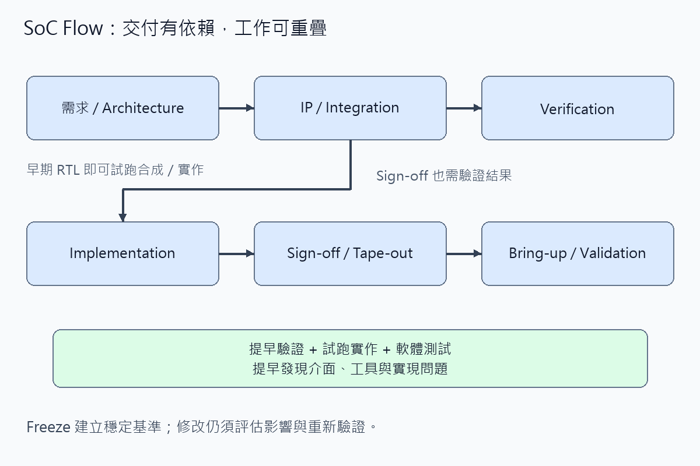

# From Requirements to Architecture

> 第二單元：從產品需求到系統規格。一個單元一份筆記，依章節逐次補充。

學習節奏：一次閱讀兩章，每章 2 題；訂正後更新 GitHub，在 HackMD 拉取閱讀。

## 1. The SoC Team and Flow

### Teams & Deliverables



| 工作 | 核心問題 | 主要交付 |
| --- | --- | --- |
| Architecture | 系統需要哪些功能與效能？ | Spec、Memory Map、時脈／電源規劃、預算 |
| IP | 單一功能如何實現？ | 設計、介面文件、驗證資料 |
| Integration | 元件如何一起運作？ | Top-level、連接與配置 |
| Verification | 行為是否符合規格？ | 測試、檢查與 coverage 結果、問題報告 |
| Implementation | 如何形成可製造電路？ | Netlist、Layout、時序等報告 |
| Validation | 真實晶片是否正常？ | 實測、韌體與問題分析 |

主要流程：需求 → 架構 → IP 與整合 → 驗證／實作 → sign-off → tape-out → bring-up。

這表示依賴關係，**不代表每個階段完全串行**。驗證、早期合成與軟體開發通常重疊進行。

RTL 模擬正確，不等於已通過合成、時序、實體設計檢查或真實晶片實測。

### Integration Is More Than Wiring

IP 各自通過測試，仍可能因雙方假設不同而整合失敗。

自訂例子：

```text
DMA 硬體：DONE = 最後一筆資料已交給 UART FIFO
軟體假設：DONE = UART 最後一個 bit 已送出
結果：看到 DMA DONE 就關 UART，截斷剩餘傳送。
```

修正方法：

1. Spec 清楚分開「DMA 搬移完成」與「UART 實體傳送完成」。
2. 軟體先確認 DMA 完成，再依 UART 規格確認傳送完成，才關閉裝置。
3. 若使用 BUSY，必須明確定義它是否包含 FIFO 內待傳送資料與正在序列傳送的資料。
4. 加入系統測試：FIFO 尚有資料時，不可提早關閉 UART。

**不能只把問題歸咎於某個 IP；要核對規格、實作與軟體對介面的理解是否一致。**

整合需要一致的位址、register 語義、clock / reset 條件、握手、錯誤、完成條件、中斷與資料所有權規則。

### Why Start Verification and Implementation Early?

若等 RTL freeze 才開始，工具不相容、規格誤解、時序或面積問題會在後期一起出現，可能迫使已完成工作重做。

| 提早執行的工作 | 可提早發現 |
| --- | --- |
| 驗證與系統測試 | 功能與介面假設不一致 |
| 試跑合成／實作 | 工具支援問題、時序與面積風險 |
| 軟體在模擬／原型執行 | register 定義、初始化與完成條件問題 |

目的不只是「能邊改邊做」，而是**在修改成本較低時發現問題，縮短回饋時間**。重疊也會有版本變動與重做風險，需用版本管理和受控變更管理。

### Freeze, ECO, Tape-out

* Freeze：建立穩定基準，之後修改需評估影響與重新驗證，不是有 bug 也不能改。
* Spec freeze 後改位址或介面，可能影響多個團隊。
* RTL freeze 後修正，需確認相關驗證與實作結果。
* ECO（Engineering Change Order）：受控工程修改。
* Tape-out：最終設計資料交付製造；後續硬體修改可能涉及重新製造。
* Bring-up：拿到實際晶片後啟動、量測並檢查系統。

### Quiz Review

1. **方向正確，補足修正**：回答「Spec 沒有訂好」抓到語義不一致。應明確定義兩種完成狀態，並讓軟體等待 UART 實體傳送完成後再關閉，加入對應系統測試。
2. **方向正確，補足風險**：提早修改有幫助；更關鍵的是避免等 freeze 後才發現系統、工具與實作問題，造成跨團隊重做、重新驗證及時程延誤。

### Source

* [ChipVerify — The SoC Team and Flow](https://chipverify.com/soc-design/soc-team-and-flow)
* DMA / UART 完成語義案例與圖解為自訂教學整理。

## 2. From Use Cases to Requirements

待學習。

## 3. The System Architecture Spec

待學習。

## 4. Memory Maps and Address Decoding

待學習。

## 5. Boot ROM and the Boot Flow

待學習。
