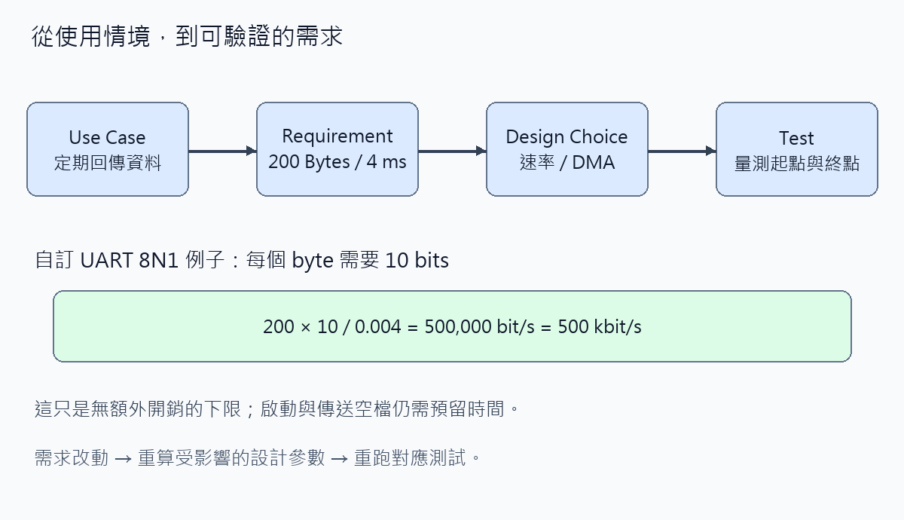
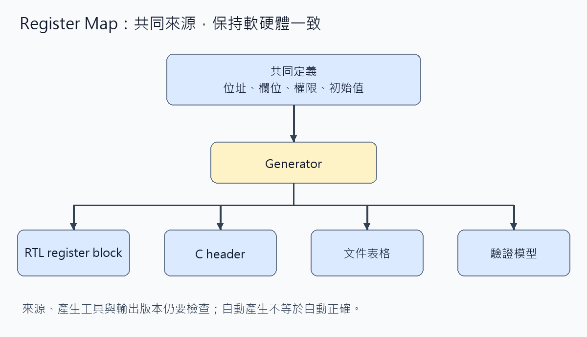
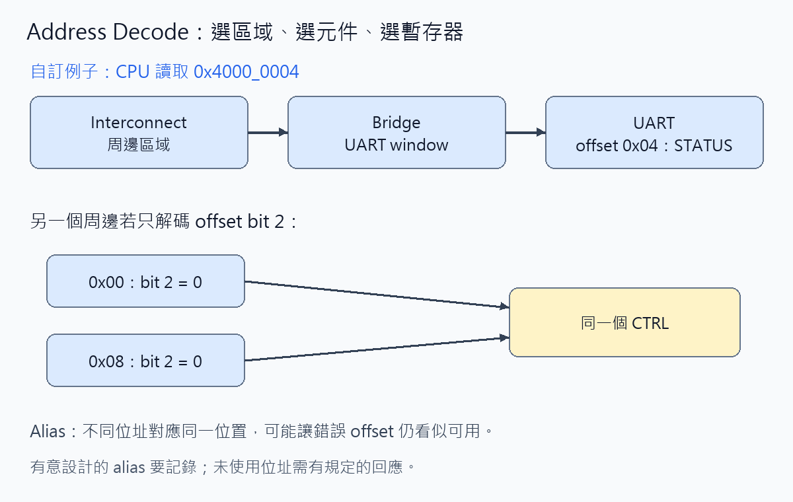
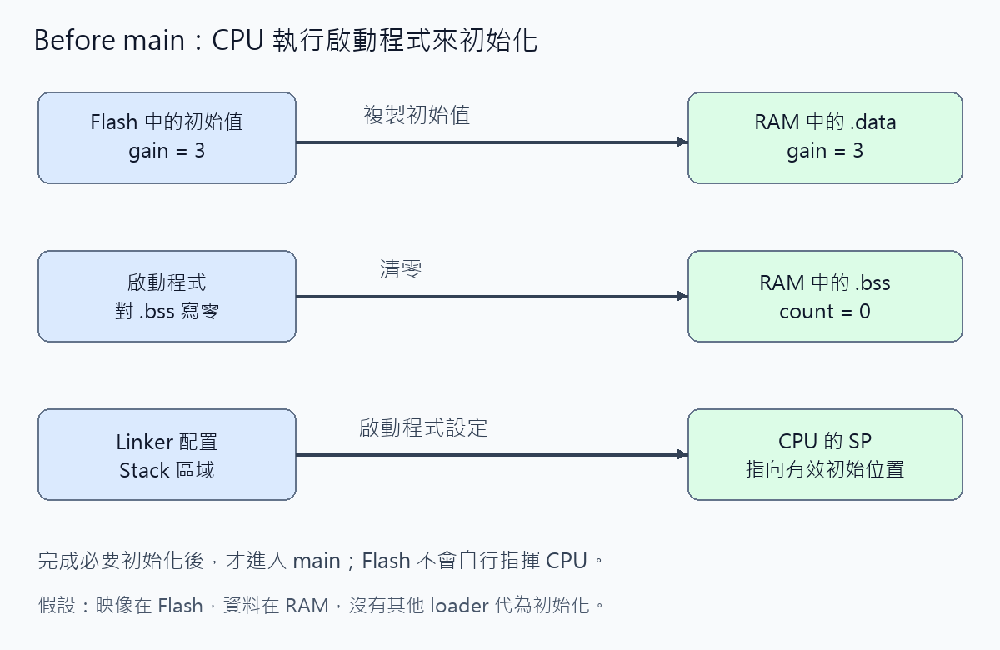

# From Requirements to Architecture

## 1. The SoC Team and Flow

### Teams & Deliverables


| 工作 | 核心問題 | 主要交付 |
| --- | --- | --- |
| Architecture | 系統需要哪些功能與效能？ | Spec、Memory Map、時脈／電源規劃、預算 |
| IP | 單一功能如何實現？ | 設計、介面文件、驗證資料 |
| Integration | 元件如何一起運作？ | Top-level、連接與配置 |
| Verification | 行為是否符合規格？ | 測試、檢查與 coverage 結果、問題報告 |
| Implementation | 如何形成可製造電路？ | Netlist、Layout、時序等報告 |
| Validation | 真實晶片是否正常？ | 實測、韌體與問題分析 |

主要流程：需求 → 架構 → IP 與整合 → 驗證／實作 → sign-off → tape-out → bring-up。

這表示依賴關係，**不代表每個階段完全串行**。驗證、早期合成與軟體開發通常重疊進行。

RTL 模擬正確，不等於已通過合成、時序、實體設計檢查或真實晶片實測。

### Integration Is More Than Wiring

IP 各自通過測試，仍可能因雙方假設不同而整合失敗。

自訂例子：

```text
DMA 硬體：DONE = 最後一筆資料已交給 UART FIFO
軟體假設：DONE = UART 最後一個 bit 已送出
結果：看到 DMA DONE 就關 UART，截斷剩餘傳送。
```

修正方法：

1. Spec 清楚分開「DMA 搬移完成」與「UART 實體傳送完成」。
2. 軟體先確認 DMA 完成，再依 UART 規格確認傳送完成，才關閉裝置。
3. 若使用 BUSY，必須明確定義它是否包含 FIFO 內待傳送資料與正在序列傳送的資料。
4. 加入系統測試：FIFO 尚有資料時，不可提早關閉 UART。

**不能只把問題歸咎於某個 IP；要核對規格、實作與軟體對介面的理解是否一致。**

整合需要一致的位址、register 語義、clock / reset 條件、握手、錯誤、完成條件、中斷與資料所有權規則。

### Why Start Verification and Implementation Early?

若等 RTL freeze 才開始，工具不相容、規格誤解、時序或面積問題會在後期一起出現，可能迫使已完成工作重做。

| 提早執行的工作 | 可提早發現 |
| --- | --- |
| 驗證與系統測試 | 功能與介面假設不一致 |
| 試跑合成／實作 | 工具支援問題、時序與面積風險 |
| 軟體在模擬／原型執行 | register 定義、初始化與完成條件問題 |

目的不只是「能邊改邊做」，而是**在修改成本較低時發現問題，縮短回饋時間**。重疊也會有版本變動與重做風險，需用版本管理和受控變更管理。

### Freeze, ECO, Tape-out

* Freeze：建立穩定基準，之後修改需評估影響與重新驗證，不是有 bug 也不能改。
* Spec freeze 後改位址或介面，可能影響多個團隊。
* RTL freeze 後修正，需確認相關驗證與實作結果。
* ECO（Engineering Change Order）：受控工程修改。
* Tape-out：最終設計資料交付製造；後續硬體修改可能涉及重新製造。
* Bring-up：拿到實際晶片後啟動、量測並檢查系統。

### Key Takeaways

* SoC 開發依賴跨團隊交付；IP 各自正確不保證系統整合正確。
* 介面語義、完成條件與錯誤行為必須一致。
* 驗證、軟體與試跑實作提早介入，在修改成本較低時發現問題。
* Freeze 是受控變更的基準，不是停止修正問題。
* **關鍵字：Architecture、Integration、Verification、Implementation、Freeze、ECO、Tape-out、Bring-up。**

### Source

* [ChipVerify — The SoC Team and Flow](https://chipverify.com/soc-design/soc-team-and-flow)
* DMA / UART 完成語義案例與圖解為自訂教學整理。

## 2. From Use Cases to Requirements

### Use Case → Requirement → Design Choice

| 層次 | 回答什麼？ | 自訂例子 |
| --- | --- | --- |
| Use Case | 使用者要做什麼？ | 定期回傳感測資料，同時執行控制工作 |
| Requirement | 必須達成什麼結果？ | 每批 100 Bytes 在指定起終點間不超過 2 ms |
| Design Choice | 選什麼方法達成？ | DMA 搬移、UART 速率、buffer 配置 |

**使用 DMA 是設計選擇，不保證資料一定準時送完。** 還要檢查終端速率、啟動成本、資源競爭與等待。

### Testable Requirements

「UART 要快」不能直接判定 pass / fail。需求應列出條件、資料量、起點、終點、上限與單位。

自訂需求範例：

> 正常工作模式下，UART 初始 idle，100 Bytes 已在來源 buffer 就緒且設定有效；從 DMA 接受 START 寫入的時脈邊緣，到 UART 最後一個 stop bit 傳送結束，時間不得超過 2 ms。

* 量測起點要選明確事件，不能只說「開始」。若產品要求包括 CPU 發出指令前後的延遲，起點也要相應調整。
* 記錄 ID、來源 Use Case、負責人、驗證方法與優先級。
* 同時執行的工作也要納入條件，例如 UART 工作期間的 CPU 控制期限。
* 功耗、容量與成本也可以是需求；電池壽命可轉換成含休眠與喚醒成本的平均能量預算。

### Derive a Limit, Then Verify

UART 8N1：1 start + 8 data + 1 stop = **10 bits / byte**。

計算範例：200 Bytes，最多 4 ms。

```text
總位元數 = 200 × 10 = 2,000 bits
4 ms = 0.004 s
理想最低速率 = 2,000 / 0.004
             = 500,000 bit/s = 500 kbit/s
```

反向檢查：若選擇 200 kbit/s，所需時間為：

```text
2,000 / 200,000 = 0.01 s = 10 ms → 超過 4 ms
```

**剛好 500 kbit/s 時，線上傳送就用完 4 ms，沒有啟動與空檔的餘裕。**

```text
總時間 = 啟動／準備 + 接腳傳送 + 中途空檔
```

模型是預估，需保留合理餘裕並用測試確認，不能直接當作通過證據。

### Traceability



Use Case → Requirement → 設計決定 → 驗證測試。資料量或期限變動時，可沿連結找到要重算的參數與要重跑的測試。

### Key Takeaways

* Use Case 描述情境；Requirement 定義可驗證結果；Design Choice 是達成結果的方法。
* 需求要寫清楚條件、資料量、量測起終點、數值與單位。
* 速率推導需包含協定開銷，並檢查 bits / Bytes 與時間單位。
* 理想模型需預留餘裕，再以測試確認；同時執行的工作也要納入評估。
* **關鍵字：Use Case、Requirement、Design Choice、Verification Method、Margin、Traceability。**

### Source

* [ChipVerify — From Use Cases to Requirements](https://chipverify.com/soc-design/from-use-cases-to-requirements)
* 需求、計算與圖解均為本次自訂教學範例。

## 3. The System Architecture Spec

### Purpose & Contents

**Requirement 定義必須達成的結果；Architecture Spec 定義系統組成、連接與對外行為。**

| 項目 | 定義內容 |
| --- | --- |
| Block / Interface | IP、版本、介面、連接 |
| Memory Map | 各元件的位址範圍 |
| Register Map | Offset、欄位、權限、reset value、副作用 |
| Interrupt | 觸發、目的地、清除方式 |
| Clock / Reset / Power | 時脈、啟動／關閉順序與模式 |
| Performance | 指定條件下的 latency / bandwidth 等預算 |
| Error handling | 非法存取、忙碌操作、傳送錯誤等行為 |
| Debug / Test / Security | 系統需提供的檢查、測試與保護能力 |

規格著重介面與行為；內部 FSM 如何編碼等細節通常留給 IP 設計文件，但會影響整合的容量與並行能力需定義清楚。

### Define DONE Precisely

完成條件需指定可觀察事件：只讀完來源，可能尚未寫完目的地；只送出寫入資料，也可能還沒收到回應。

以下為**自訂 DMA 規格**，不是所有 DMA 的共同定義：

| 項目 | 定義 |
| --- | --- |
| DONE 設為 1 | 指定長度的資料全部成功搬移，最後一筆目的端寫入已收到成功回應 |
| 不代表什麼 | 不代表 UART 接腳最後一個 bit 已送出 |
| Reset value | DONE = 0 |
| 新 START | 接受新命令時清除上次 DONE |
| 軟體清除 | 對 DONE 寫 1 清除（W1C） |
| 搬移錯誤 | 設 ERROR，本次不設 DONE；停止發出後續資料請求，已發出請求依定義收尾 |
| Interrupt | DONE 或 ERROR 且對應中斷已啟用時提出請求 |

在這個定義下，DONE 表示「成功完成」，ERROR 表示「失敗」。另一種設計也可能讓 DONE 表示「作業已結束」，再由 ERROR 區分結果；兩種都需清楚寫進規格。

其他要定義的邊界：忙碌時再次 START、Length = 0、非法位址、保留位元、reset 中的交易處理等。

### One Source, Generated Outputs



若 RTL 的 STATUS 改到 offset 0x08，C header 還是 0x04，軟體可能讀到其他 register 或非法位址，造成狀態誤判。

**用同一份機器可讀描述，產生文件、RTL register block、C header 與驗證模型，降低手動多份維護的分歧。**

* 產生後各輸出仍要使用相同版本。
* 來源定義與 generator 本身仍需 review / verification。
* 修改要有版本紀錄與影響評估；自動產生不代表內容自動正確。

### Key Takeaways

* Architecture Spec 定義系統組成、介面與對外行為，供各團隊共同依循。
* Register 定義要包含位址、欄位、權限、reset value、副作用與邊界行為。
* DONE、BUSY、ERROR 必須有精確語義，不能只憑名稱推測。
* 共同來源產生 RTL、C header、文件與驗證模型，並管理版本與產生工具的正確性。
* **關鍵字：Architecture Spec、Memory Map、Register Map、Reset Value、Side Effect、Error Handling、Single Source。**

### Source

* [ChipVerify — The System Architecture Spec](https://chipverify.com/soc-design/system-architecture-spec)
* DONE、ERROR 與 START 行為為自訂教學規格，實際產品應依其文件。

## 4. Memory Maps and Address Decoding

> 基礎概念參見[第一單元：What Is in an SoC 與 MMIO](https://github.com/ray13542/soc_note/blob/main/01_How_a_System_Works.md)。本章補充範圍、對齊、分層解碼、alias 與不同存取者的位址視角。

### Range & Alignment

Address space 是可表示的位址範圍，不等於實際裝設的記憶體容量。

```text
有效範圍：Base ≤ Address < Base + Size
最後一個 byte 位址 = Base + Size − 1

例：SRAM Base = 0x2000_0000，Size = 8 KiB = 0x2000 Bytes
最後位址 = 0x2000_1FFF
0x2000_2000 已超出範圍。
```

* 常見區域大小是 2 的次方，Base 依大小對齊，方便以高位元辨識區域、低位元作 offset。
* 4 KiB = 2^12 Bytes；對齊的 4 KiB 區域可用低 12 bits 作內部 offset。
* 這是簡化解碼的常見方式，不是所有系統都必須遵守的限制。
* 保留擴充空間可降低未來改位址造成的軟體相容性問題。
* Peripheral window 大小不等於實際儲存容量：4 KiB window 可能只放幾個 register。

### Hierarchical Decoding & Aliases



分層解碼：Interconnect 選大區域 → Bridge 選周邊 → 周邊依 offset 選 register。每層只需處理自己的範圍與介面。

自訂 partial decoding 範例：周邊只看 offset bit 2。

| Offset | bit 2 | 目標 |
| --- | --- | --- |
| 0x00 | 0 | CTRL |
| 0x04 | 1 | STATUS |
| 0x08 | 0 | CTRL |
| 0x0C | 1 | STATUS |

**不同位址選到同一個位置，稱為 Address Alias。** Driver 即使把 CTRL offset 誤寫成 0x08，仍可能操作成功，掩蓋錯誤；新版增加 register 或改用完整解碼後才失效。

* Alias 可以是刻意設計，例如 boot remapping；必須在規格中明確記錄。
* 未使用位址要有規定的回應，不能無限等待。回錯誤時，CPU 是否進入 exception，取決於其架構與系統設計。
* 測試需涵蓋範圍邊界、未使用 offset、重疊與非預期 alias。

### Manager Views & Software

CPU 與 DMA 可能有不同可達範圍，甚至同一儲存體對應不同位址。傳遞 buffer address 前，要確認可達性與位址轉換規則。

Linker script 與 C header 必須跟硬體 map 一致；共同來源產生方式參見本單元第 3 章。

### Key Takeaways

* 邊界用 Base + Size − 1 計算，避免 off-by-one。
* 對齊與分層解碼簡化硬體；window 不代表實際儲存容量。
* Partial decoding 可能產生 alias，讓錯誤位址看起來可用。
* CPU 可用的位址，不保證 DMA 可直接使用。
* **關鍵字：Address Space、Base、Size、Alignment、Hierarchical Decoding、Partial Decoding、Alias、Remapping。**

### Source

* [ChipVerify — Memory Maps and Address Decoding](https://chipverify.com/soc-design/memory-maps-and-address-decoding)
* SRAM 邊界、周邊位址與 alias 表格為自訂教學例子。

## 5. Boot ROM and the Boot Flow

> 記憶體種類、TCM 配置與 reset 基礎參見[第一單元第 6、7 章](https://github.com/ray13542/soc_note/blob/main/01_How_a_System_Works.md)。本章聚焦啟動階段、C 執行環境、信任鏈與模擬測試的差異。

### Reset Entry & Boot Stages

CPU reset 後的起始取指／向量讀取規則由處理器與 SoC 決定，不是所有系統都直接在位址 0 執行第一條指令。

```text
常見分階段流程：
Reset → Boot ROM → 片上 SRAM 中的 Bootloader → Firmware / OS
```

* Boot ROM 做最小初始化、選開機來源、載入下一階段，依安全政策驗證後轉移控制權。
* 可更新的 Bootloader 可存於 Flash，載入 SRAM 後執行；它可以初始化 DRAM，再載入較大的程式。
* 每階段準備下一階段所需資源；DRAM 在控制器初始化／訓練前通常不能直接使用。
* 小型 MCU 可能直接從可取指的 Flash 執行，流程不必包含每個階段。
* 映像損壞或來源不可用時，需定義備援、timeout 與 recovery 行為。

### Before main: Establish the C Environment

**Flash 是儲存程式與初始資料的媒介，不是自行發出命令的角色。CPU 執行 Bootloader／啟動程式中的指令，完成載入與初始化。**

假設全域變數如下，映像存於 Flash，執行時資料放在 RAM，沒有其他 loader 代為初始化：

```c
int gain = 3;
int count;
```



| 區域 | 典型內容 | 啟動時處理 |
| --- | --- | --- |
| .text | 機器指令 | 讓程式位於可執行位置 |
| .rodata | 常數 | 讓常數位於可讀位置 |
| .data | 有初始值的可寫靜態資料，例如 gain | 必要時從 Flash／ROM 複製初始值到 RAM 執行位置 |
| .bss | 需零初始化的靜態資料，例如 count | 清為 0 |
| stack | 函式呼叫所需空間 | 將 SP 設到配置且符合對齊規則的初始位置 |

* `gain` 在 RAM 的內容必須初始化成 3。
* 全域 `count` 雖未明寫初始值，C 語意要求它初始為 0；由此啟動環境建立該狀態。
* 不可把此規則套用到所有未初始化的區域變數。
* Linker 決定區域與位址，CPU 執行的啟動程式使用這些資訊完成準備，之後呼叫 main。
* RAM 上電內容不可當作已正確初始化；.bss 通常不需在映像中逐 byte 儲存零值，但仍占執行時 RAM。
* 若其他 loader 已完成某項初始化，分工可調整；仍須確保進入 main 前的條件成立。

### Secure Boot & Trust

下一階段可能來自可更新／替換的 Flash，執行前需依安全政策檢查授權與完整性。

```text
可信任的起點 → 驗證下一階段 → 通過才執行 → 繼續驗證後續階段
```

* 簽章檢查主要確認映像符合受信任金鑰所代表的授權政策，且簽署後的內容未被修改。
* **簽章驗證不是掃毒，不保證沒有漏洞、惡意邏輯或功能 bug。** 經授權簽署的程式也可能有問題。
* 簽章與加密是不同目的；只檢查檔案存在或自稱正版也不足以建立信任。
* 信任起點的程式／金鑰資料需受到保護；驗證失敗的恢復流程也要設計。

### Simulation: Fast Functional Tests vs Real Boot Tests

RTL 模擬在晶片尚未製造時，計算硬體訊號行為，便於觀察與修正設計；通常比真實硬體慢。

| 測試方式 | 用途與範圍 |
| --- | --- |
| 預載入 RAM / TCM | 測試程式與必要初始狀態先放好，縮短重複開機的模擬時間，集中檢查 UART／DMA 等功能 |
| 完整開機 | 從 reset 與真正開機來源走過 Boot ROM、Flash controller、載入、驗證、初始化與控制轉移 |

**預載入功能測試成功，不證明被跳過的開機路徑正確。** 另需驗證 .data 複製、.bss 清零、stack 設定，以及映像錯誤與 recovery 等情境。

### Key Takeaways

* CPU 執行啟動程式，Flash／ROM 保存其指令與資料；儲存媒介本身不主動指揮 CPU。
* 每個開機階段先準備下一階段需要的資源。
* 進 main 前確認資料初值、零初始化與 stack；不要假設 RAM 上電就是正確值。
* Secure Boot 檢查授權與完整性，不保證程式沒有 bug 或病毒。
* 預載入測功能與完整開機測試互補，證明範圍不同。
* **關鍵字：Reset Vector、Boot ROM、Bootloader、.data、.bss、Stack Pointer、Chain of Trust、Backdoor Loading、Recovery。**

### Source

* [ChipVerify — Boot ROM and the Boot Flow](https://chipverify.com/soc-design/boot-rom-and-boot-flow)
* gain / count 與圖解為自訂教學範例；實際 section 配置及啟動分工依工具鏈和系統。
