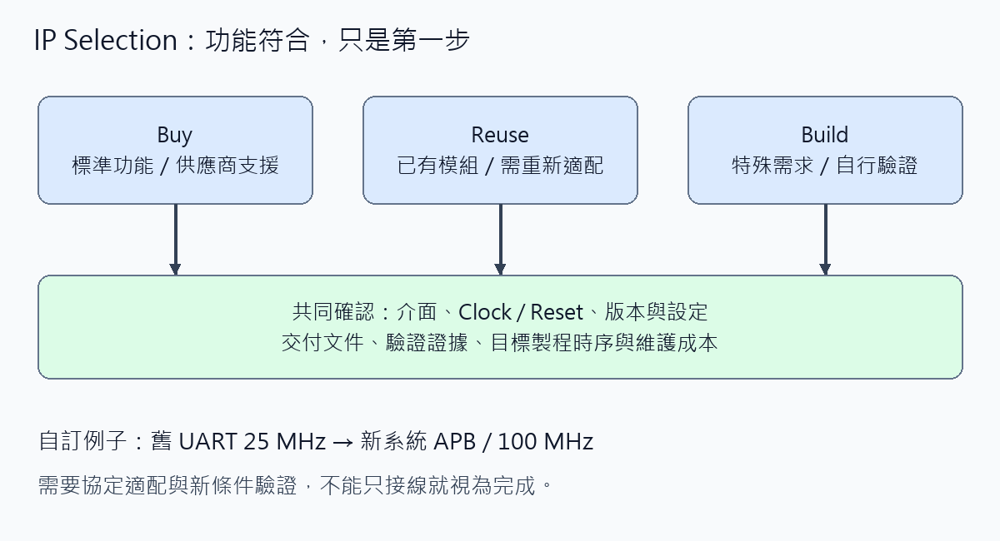

# Building with IP

## 1. Buy, Reuse or Build: Choosing IP

### IP Selection

IP 是可整合進 SoC 的功能模組，例如 CPU、UART、DMA。選擇時除了功能，也要評估整合、驗證與維護成本。

| 方式 | 適用情況 | 主要代價 |
| --- | --- | --- |
| Buy | 複雜的標準功能 | 授權費、供應商依賴、修改限制 |
| Reuse | 已有接近需求的模組 | 介面適配、重新驗證與維護 |
| Build | 特殊需求或產品差異所在 | 設計、驗證與時程風險 |



**重用不代表零整合成本；以前驗證過，也不代表新版本或新設定已驗證。**

自訂例子：舊 UART 使用自訂介面，只驗證過 25 MHz；新系統使用 APB、100 MHz。需要處理協定適配，並確認新時脈下的功能與時序；不能只連線就視為完成。

### Deliverables & Implementation

除了設計本身，還需要介面與 register 文件、clock / reset 要求、驗證資料、時序限制、軟體支援及已知問題。評估證據時，要對準**實際使用的版本與設定**。

| 交付形式 | 意義 | 注意事項 |
| --- | --- | --- |
| Soft IP | 通常以 RTL 交付 | 仍須合成、實體設計與時序驗證 |
| Hard IP | 已完成的實體布局及模型 | 通常受製程與實體使用條件限制 |

自訂例子：拿到 CPU RTL，不代表已達到 100 MHz。能否達標還取決於目標製程、library、實作與限制條件，需用時序結果確認。

**開放 ISA 不等於特定 CPU IP 的自由授權。** RISC-V 定義指令集；某個 CPU 實作是否免費、允許修改，仍取決於該 IP 的授權條款。

### Key Takeaways

* 選 IP 要比較功能、整合成本與驗證證據。
* 重用仍需確認新系統的介面、clock / reset 與設定。
* RTL 是實作起點，不是目標製程效能的保證。
* **關鍵字：Buy、Reuse、Build、Soft IP、Hard IP、Deliverables、Configuration。**

### Source

* [ChipVerify — Choosing IP](https://chipverify.com/soc-design/choosing-ip)
* UART 適配與頻率案例、圖解為自訂教學整理。

## 2. Integrating the CPU Subsystem

### Integration Scope

CPU 整合需確認取指令、資料存取、interrupt、debug 與啟動條件。Memory / cache / TCM 原理見[第一單元](01_How_a_System_Works.md)；boot 與 memory map 見[第二單元](02_Requirements_to_Architecture.md)，此處只補充新的整合觀點。

### Shared Memory & Arbitration


自訂例子：取指令與資料寫入同時到達同一個 single-port SRAM，不能假設兩筆都在同一拍完成。

* 保留 single-port SRAM 時，可由 arbiter 選擇其中一筆，另一筆等待。
* 尚未接受的 request，依介面規則保留或緩存，不能遺失。
* 其他設計選項包括分開 instruction / data memory，或使用合適的多埠記憶體。

### Variable Latency

CPU 必須能處理不同的回應延遲，不能只在「下一拍一定回應」的模擬環境中測試。

```text
T0：發出讀取 request
T1、T2：response 尚未有效，等待
T3：收到有效 response，才使用回傳資料
```

自訂檢查案例：讓 memory 延後數拍回應，確認 CPU 不會提早使用資料。對 UART FIFO 寫入加入等待，確認同一筆存取沒有被錯誤執行兩次。

**等待不等於重新執行交易。** Request 被接受與 response 回傳可能是不同時點，應依協定分別追蹤。

### Hardware / Software Configuration

軟體工具設定必須符合實際 CPU configuration。

自訂例子：CPU 只支援 RV32I，編譯器卻產生 M extension 的 `MUL`，且沒有相應的軟體模擬處理，就會因不支援該指令而觸發 illegal-instruction exception。應核對 compiler 的目標 ISA 設定與實際硬體，而非直接認為 memory 接錯。

| 項目 | 整合時確認 |
| --- | --- |
| ISA / extensions | 編譯產物符合硬體支援能力 |
| Interrupt | 編號、edge / level 與清除語義一致 |
| Reset / Boot | 第一筆取指令發出時，目標與路徑已可用 |
| Debug | halt、single-step 等功能與存取權限符合規格 |

### Key Takeaways

* 共用資源的衝突需要仲裁與正確等待。
* 驗證需涵蓋不同延遲，避免提早用資料或重複存取。
* CPU configuration 必須與編譯器及軟體假設一致。
* **關鍵字：CPU Subsystem、Arbitration、Stall、Variable Latency、ISA Extension、Debug。**

### Source

* [ChipVerify — Integrating the CPU Subsystem](https://chipverify.com/soc-design/integrating-the-cpu-subsystem)
* 仲裁、延遲與指令不匹配案例、圖解為自訂教學整理。

## 3. Peripherals: UART, Timers and GPIO

待學習。

## 4. Accelerators and Hardware/Software Partitioning

待學習。

## 5. Top-Level Integration and Connectivity Checks

待學習。
