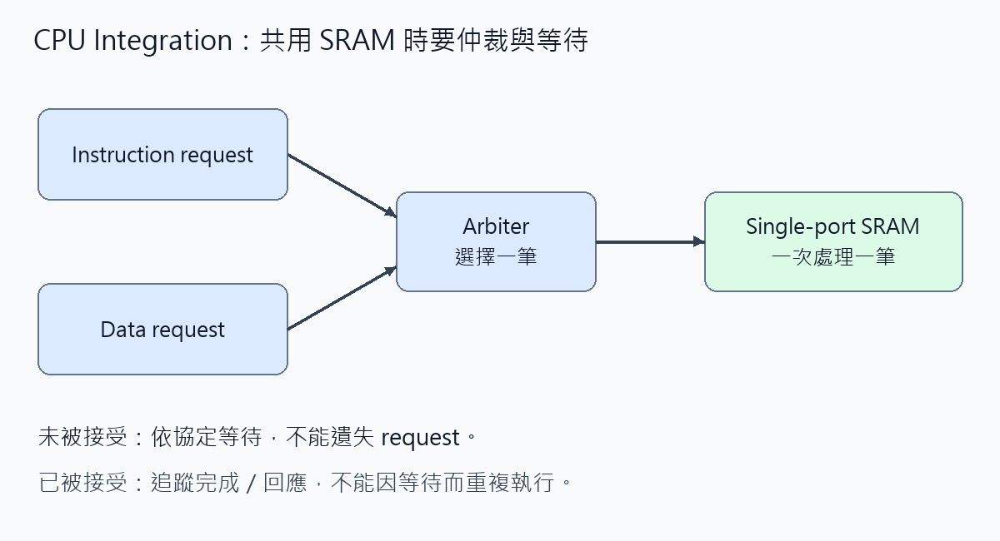
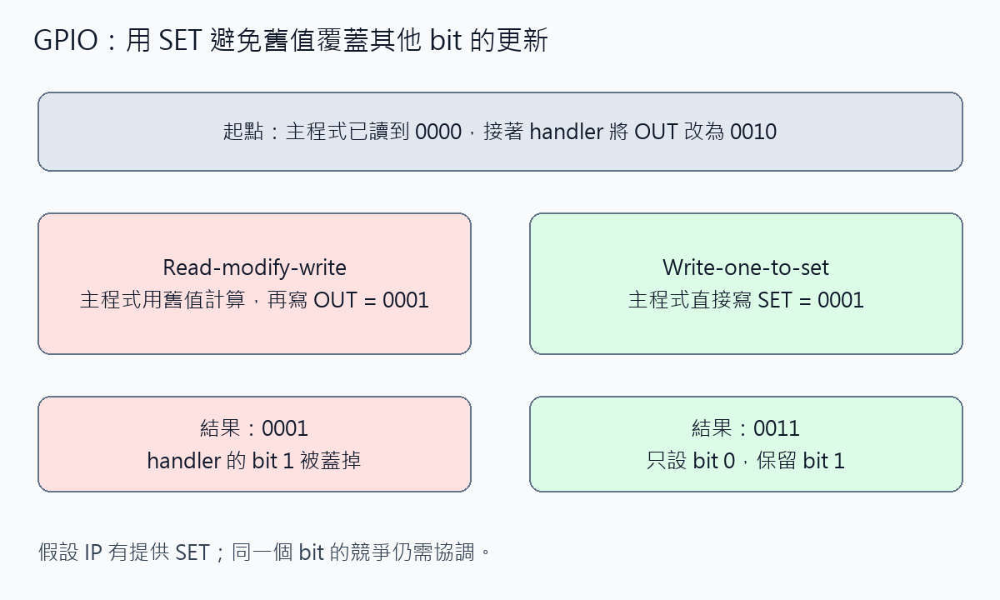
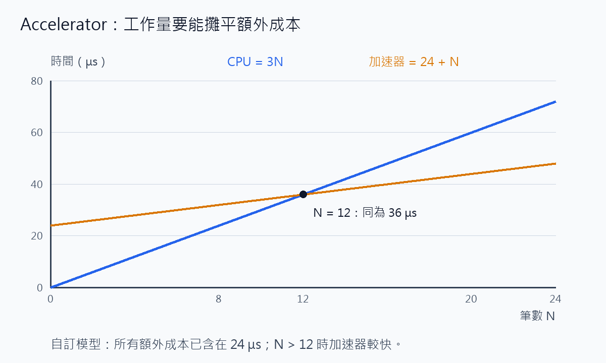
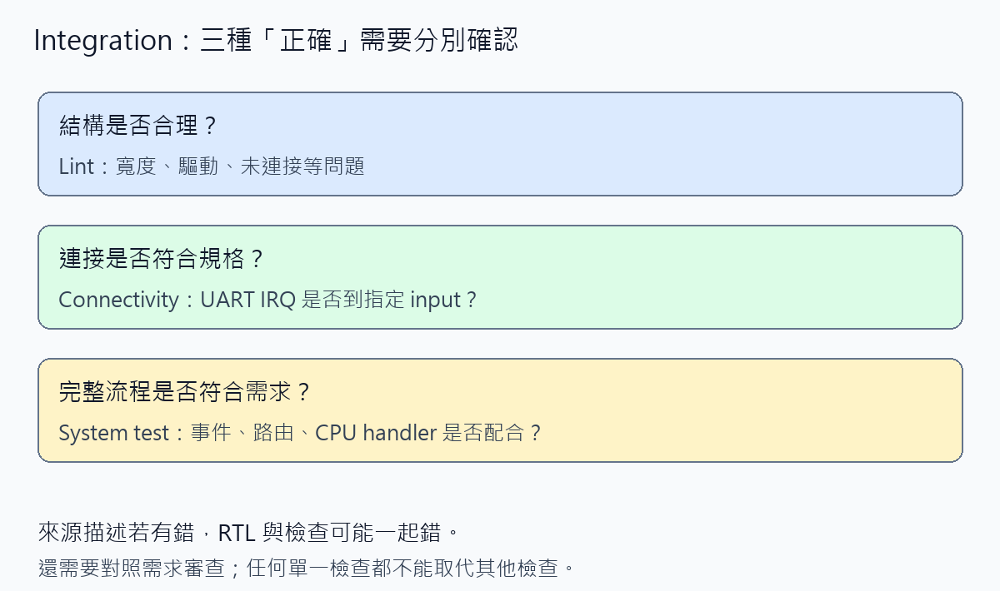

# Building with IP

## 1. Buy, Reuse or Build: Choosing IP

### IP Selection

IP 是可整合進 SoC 的功能模組，例如 CPU、UART、DMA。選擇時除了功能，也要評估整合、驗證與維護成本。

| 方式 | 適用情況 | 主要代價 |
| --- | --- | --- |
| Buy | 複雜的標準功能 | 授權費、供應商依賴、修改限制 |
| Reuse | 已有接近需求的模組 | 介面適配、重新驗證與維護 |
| Build | 特殊需求或產品差異所在 | 設計、驗證與時程風險 |


**重用不代表零整合成本；以前驗證過，也不代表新版本或新設定已驗證。**

自訂例子：舊 UART 使用自訂介面，只驗證過 25 MHz；新系統使用 APB、100 MHz。需要處理協定適配，並確認新時脈下的功能與時序；不能只連線就視為完成。

### Deliverables & Implementation

除了設計本身，還需要介面與 register 文件、clock / reset 要求、驗證資料、時序限制、軟體支援及已知問題。評估證據時，要對準**實際使用的版本與設定**。

| 交付形式 | 意義 | 注意事項 |
| --- | --- | --- |
| Soft IP | 通常以 RTL 交付 | 仍須合成、實體設計與時序驗證 |
| Hard IP | 已完成的實體布局及模型 | 通常受製程與實體使用條件限制 |

自訂例子：拿到 CPU RTL，不代表已達到 100 MHz。能否達標還取決於目標製程、library、實作與限制條件，需用時序結果確認。

**開放 ISA 不等於特定 CPU IP 的自由授權。** RISC-V 定義指令集；某個 CPU 實作是否免費、允許修改，仍取決於該 IP 的授權條款。

### Key Takeaways

* 選 IP 要比較功能、整合成本與驗證證據。
* 重用仍需確認新系統的介面、clock / reset 與設定。
* RTL 是實作起點，不是目標製程效能的保證。
* **關鍵字：Buy、Reuse、Build、Soft IP、Hard IP、Deliverables、Configuration。**

### Source

* [ChipVerify — Choosing IP](https://chipverify.com/soc-design/choosing-ip)
* UART 適配與頻率案例、圖解為自訂教學整理。

## 2. Integrating the CPU Subsystem

### Integration Scope

CPU 整合需確認取指令、資料存取、interrupt、debug 與啟動條件。Memory / cache / TCM 原理見[第一單元](01_How_a_System_Works.md)；boot 與 memory map 見[第二單元](02_Requirements_to_Architecture.md)，此處只補充新的整合觀點。

### Shared Memory & Arbitration



自訂例子：取指令與資料寫入同時到達同一個 single-port SRAM，不能假設兩筆都在同一拍完成。

* 保留 single-port SRAM 時，可由 arbiter 選擇其中一筆，另一筆等待。
* 尚未接受的 request，依介面規則保留或緩存，不能遺失。
* 其他設計選項包括分開 instruction / data memory，或使用合適的多埠記憶體。

### Variable Latency

CPU 必須能處理不同的回應延遲，不能只在「下一拍一定回應」的模擬環境中測試。

```text
T0：發出讀取 request
T1、T2：response 尚未有效，等待
T3：收到有效 response，才使用回傳資料
```

自訂檢查案例：讓 memory 延後數拍回應，確認 CPU 不會提早使用資料。對 UART FIFO 寫入加入等待，確認同一筆存取沒有被錯誤執行兩次。

**等待不等於重新執行交易。** Request 被接受與 response 回傳可能是不同時點，應依協定分別追蹤。

### Hardware / Software Configuration

軟體工具設定必須符合實際 CPU configuration。

自訂例子：CPU 只支援 RV32I，編譯器卻產生 M extension 的 `MUL`，且沒有相應的軟體模擬處理，就會因不支援該指令而觸發 illegal-instruction exception。應核對 compiler 的目標 ISA 設定與實際硬體，而非直接認為 memory 接錯。

| 項目 | 整合時確認 |
| --- | --- |
| ISA / extensions | 編譯產物符合硬體支援能力 |
| Interrupt | 編號、edge / level 與清除語義一致 |
| Reset / Boot | 第一筆取指令發出時，目標與路徑已可用 |
| Debug | halt、single-step 等功能與存取權限符合規格 |

### Key Takeaways

* 共用資源的衝突需要仲裁與正確等待。
* 驗證需涵蓋不同延遲，避免提早用資料或重複存取。
* CPU configuration 必須與編譯器及軟體假設一致。
* **關鍵字：CPU Subsystem、Arbitration、Stall、Variable Latency、ISA Extension、Debug。**

### Source

* [ChipVerify — Integrating the CPU Subsystem](https://chipverify.com/soc-design/integrating-the-cpu-subsystem)
* 仲裁、延遲與指令不匹配案例、圖解為自訂教學整理。

## 3. Peripherals: UART, Timers and GPIO

### Peripheral Integration

MMIO、FIFO、interrupt 與 CDC 原理見[第一單元](01_How_a_System_Works.md)。這裡聚焦周邊的時間、外部接腳與軟體操作。

| 周邊 | 工作 | 新的整合重點 |
| --- | --- | --- |
| UART | 串列通訊 | Baud rate、frame 格式、pin mux |
| Timer | 計時與定時事件 | Counter / Compare、觸發與解除條件 |
| GPIO | 讀取或控制 pin | Direction、SET / CLEAR、更新競爭 |

### UART & Pin Mux

```text
CPU → TX FIFO → 傳送電路 → Pin mux → 外部 pin
                  ↑
             Baud-rate 設定
```

常見 8N1 frame 包含 1 個 start bit、8 個 data bits、無 parity、1 個 stop bit；每個 byte 佔 10 個 bit 時間。

同一個 pin 可供不同功能使用，由 pin mux 選擇。自訂例子：UART 內部正常，但 pin mux 仍選 GPIO，外部就看不到預期的 UART 波形。

### Timer: Counter vs Compare

以一種簡化 timer 為例：每個 tick 增加 Counter，當 `Counter >= Compare` 時 interrupt 有效。**這是本例的規則，不代表所有 timer 都相同。**

自訂例子：每 1 μs 加 1，Counter = 200、Compare = 260，則 60 μs 後條件成立。CPU 實際進入 handler 還可能有額外延遲。

若 handler 執行時 Counter = 265，寫 Compare = 250 不會解除條件。應設定未來期限，讓 Compare 大於當時 Counter，且預留足夠時間避免寫入時期限已過。實際 interrupt 反映比較結果可能有延遲，依 IP 規格處理。

其他 timer 可能倒數、自動重載或使用獨立狀態位元。也需注意 counter 溢位，不能把有限寬度計數器當成永遠遞增。

### GPIO: Read-Modify-Write Race



自訂例子：OUT 原本為 `0000`，主程式讀取後準備設 bit 0；中途 handler 把 bit 1 設成 1。主程式仍用舊值算出 `0001` 並寫回，會覆蓋 handler 的更新。

若硬體提供 **write-one-to-set** 的 SET register，主程式對 SET 寫 `0001`，只會設定 bit 0，保留 bit 1，得到 `0011`。CLEAR 的對應設計則只清除寫入 1 的位元。

這避免不同 bit 的 read-modify-write 競爭；多個執行流程操作同一個 bit 時，仍需協調。

GPIO 輸入的同步與按鈕 debounce 是不同問題：同步器不會自動消除機械彈跳。

### Key Takeaways

* 周邊可讀寫，不代表外部 pin、時序或 interrupt 路徑正確。
* Timer 要依實際條件解除 interrupt；寫入 Compare 不一定代表解除。
* SET / CLEAR 可避免上述不同 bit 更新互相覆蓋。
* **關鍵字：UART、8N1、Pin Mux、Counter、Compare、GPIO、Read-Modify-Write、Debounce。**

### Source

* [ChipVerify — Peripherals: UART, Timers and GPIO](https://chipverify.com/soc-design/peripherals-uart-timers-gpio)
* Timer 數值、GPIO 操作案例與圖解為自訂教學整理。

## 4. Accelerators and Hardware/Software Partitioning

### Partition the Work

加速器執行特定運算；CPU 可負責參數、工作安排、啟動與錯誤處理。先量測時間花在哪裡，再決定哪些工作值得移至硬體。

自訂影像濾波案例：

| 工作 | 分配原因 |
| --- | --- |
| 大量像素的重複運算 → 硬體 | 可利用並行與 pipeline |
| 決定濾波強度 → 軟體 | 策略可隨情境或版本調整 |
| 設定 buffer、啟動與收尾 → 軟體 | 管理整體流程 |

硬體可以提供參數 register，因此使用加速器不代表所有行為固定不變。

### Amdahl's Law

**局部加速比不等於整體加速比。** 假設原始時間中比例 p 的工作加速 S 倍，其他部分不變，且忽略額外成本：

```text
整體加速比 = 1 / ((1 - p) + p / S)
```

自訂例子：原本 100 ms，其中 CPU 控制 80 ms、運算 20 ms。運算快 10 倍後：

```text
新時間 = 80 + 20 / 10 = 82 ms
整體加速比 = 100 / 82 ≈ 1.22 倍
```

即使運算瞬間完成，仍需 80 ms，最多快 1.25 倍。**未加速部分限制收益，並非抵消了已節省的時間。**

### Setup Cost & Break-Even



自訂模型（時間為 μs）：CPU = `3N`，加速器 = `24 + N`。24 已包含所有額外成本，假設工作不重疊。

| 筆數 N | CPU | 加速器 | 比較 |
| --- | --- | --- | --- |
| 8 | 24 μs | 32 μs | CPU 較快 |
| 12 | 36 μs | 36 μs | 相同 |
| 20 | 60 μs | 44 μs | 加速器較快 |

解 `24 + N < 3N` 得到 `N > 12`，整數筆數從 13 筆開始加速器較快。小工作可能無法攤平啟動與收尾成本。

### Data Supply

Bandwidth 原理見第一單元，此處只看加速器需求：自訂例子中每秒處理 1 億筆、每筆讀取 8 Bytes、無重用，需讀取頻寬 800 MB/s。只有 400 MB/s 可用時，輸入最多支撐每秒 5,000 萬筆；共用頻寬的輸出與其他流量還要另算。

### Key Takeaways

* 先量測瓶頸，再決定軟硬體分工。
* 未加速部分限制整體加速比。
* 比較完整任務時間，包含準備、資料搬移與收尾。
* 計算能力需要足夠的資料供應才能發揮。
* **關鍵字：Accelerator、HW/SW Partitioning、Profiling、Amdahl's Law、Overhead、Break-Even。**

### Source

* [ChipVerify — Accelerators and Hardware/Software Partitioning](https://chipverify.com/soc-design/accelerators-and-hw-sw-partitioning)
* 分工、時間與頻寬數值案例、圖解為自訂教學整理。

## 5. Top-Level Integration and Connectivity Checks

### Top-Level Scope

Top-level 將 CPU、memory、interconnect 與周邊實例化並連接。除了資料路徑，也包含 clock、reset、interrupt、debug、電源控制與模式設定。

CDC / reset 原理見[第一單元](01_How_a_System_Works.md)，address decoding 與單一來源生成見[第二單元](02_Requirements_to_Architecture.md)。這裡聚焦各種整合檢查的分工。

### Legal Wiring vs Correct Wiring

自訂例子：規格要求 UART IRQ → interrupt controller input 3，RTL 卻連到 input 4。兩者都是合法的 1-bit port，Lint 可能不報錯，但軟體依規格判斷時，會辨識成錯誤事件。

**Lint 通過只代表沒有發現該組規則所檢查的問題，不代表 RTL 功能正確。** Connectivity check 則核對指定來源是否到達規格要求的目的地。



| 檢查 | 主要確認 | 例子 |
| --- | --- | --- |
| Lint | RTL 結構與可疑寫法 | 未接輸入、多重驅動、寬度問題 |
| CDC / RDC | 跨 clock / reset domain 的處理 | 跨域路徑缺少適當保護 |
| Connectivity | 連線符合指定關係 | UART IRQ 接到錯誤編號 |
| Register / address test | 存取路徑與 register 行為 | 高 offset 無法到達、access type 錯誤 |
| System test | 多個模組的完整互動 | CPU 操作 UART 並接收正確事件 |

### Exercise the Real Path

自訂 UART 系統測試路徑：

```text
CPU 執行 driver → interconnect → UART registers
    → UART 外部波形 → 外部接收模型檢查
    → UART 事件 → interrupt controller → CPU handler
```

直接驅動 UART 內部介面會繞過部分路徑，不能單靠這種測試證明 CPU 至周邊的整合正確。

修正 IRQ 連線後，仍需確認 UART 在預期條件產生事件，以及 controller、CPU 和軟體能正確處理。**連接正確，不等於事件時機或整個流程正確。**

Register 測試也要依語義建立預期：一般 RW 可依規格讀回；FIFO 可能 push / pop；W1C 寫 1 是清除。不能對所有 register 都要求「寫多少就讀回多少」。相關 side effect 原理沿用第一單元。

### Generated Consistency vs Requirement Correctness

自訂例子：需求要求 UART IRQ 接 input 3，但系統描述誤寫 input 4。若 RTL 與 connectivity checks 都由這份描述產生，兩者可能一致且檢查通過，卻仍不符合需求。

**自動生成減少不同步，但不能保證來源描述本身正確。**

修正流程：

1. 對照系統需求，修正來源描述。
2. 重新生成相關 RTL、檢查、軟體定義與文件。
3. 重跑受影響的檢查與系統測試。
4. 審查結果確實符合需求，避免只證明生成結果彼此一致。

不要只修改生成後的 RTL，否則來源與結果分離，下一次生成也可能覆蓋修改。

### Key Takeaways

* 結構合法，不代表連接符合規格。
* 連接正確，不代表整個使用流程正確。
* 生成結果一致，不代表來源描述符合需求。
* 修改來源後重新生成，並重跑相關檢查與需求導向的測試。
* **關鍵字：Top-Level、Lint、CDC、RDC、Connectivity、System Test、Generator。**

### Source

* [ChipVerify — Top-Level Integration and Connectivity Checks](https://chipverify.com/soc-design/top-level-integration)
* IRQ 編號、UART 測試路徑與生成來源錯誤案例、圖解為自訂教學整理。
