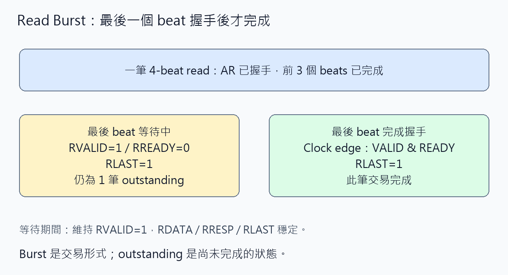

# Interconnect and Data Movement

## 1. Buses, Crossbars and Networks-on-Chip

### Protocol vs Topology

Protocol 決定交換規則，topology 決定連接結構。使用 AXI 不代表一定使用 shared bus 或 crossbar。握手與 manager / subordinate 角色見[第一單元](01_How_a_System_Works.md)。

| 結構 | 主要能力 | 主要限制 |
| --- | --- | --- |
| Shared bus | 共用路徑，結構簡單 | 不同目的端的流量仍可能爭用路徑 |
| Crossbar | 具備獨立路徑時，可同時服務不同目的端 | 同一目的 port 仍需仲裁；連線成本隨規模成長 |
| NoC | 交易封包經 router / link 分段傳送 | Hop 延遲、buffer 與路由管理；共用 link 仍會競爭 |

真實 SoC 可混用不同結構，高流量區域用 crossbar / NoC，低流量周邊透過 bridge 連接。

### Destination Bottlenecks


自訂例子：CPU 讀 SRAM、DMA 寫 UART，具備獨立路徑的 crossbar 可讓兩者並行。若兩者都存取同一個每 cycle 只能接受一筆的 SRAM port，仍只能每 cycle 接受一筆。

**增加路徑不等於增加目的端容量。** 應同時檢查路徑、仲裁與接收端的實際處理能力。

### Key Takeaways

* Protocol 描述溝通規則，topology 描述連接結構。
* Crossbar 的並行收益取決於流量是否使用不同目的端與獨立資源。
* NoC 可擴展，但不是沒有等待或共用瓶頸。
* **關鍵字：Shared Bus、Crossbar、NoC、Topology、Hop、Contention。**

### Source

* [ChipVerify — Buses, Crossbars and Networks-on-Chip](https://chipverify.com/soc-design/buses-crossbars-and-nocs)
* CPU / DMA 路徑案例與圖解為自訂教學整理。

## 2. Outstanding Transactions and Bursts

### Outstanding vs Burst

**Outstanding 描述交易尚未完成的狀態；burst 描述一筆交易包含多個 data beats。兩者可以同時成立。**

以 AXI read 為例：AR 位址已握手，但最後一個 R beat 尚未握手完成，該交易仍算 outstanding。

| 名詞 | 在數什麼？ |
| --- | --- |
| Outstanding count | 已接受、尚未完成的交易數（此處以 read 為例） |
| Burst length | 每筆交易包含的 data beats 數 |
| Beat | 資料通道的一次傳輸，依握手判斷是否完成 |

自訂例子：3 筆 read 都已接受，每筆 4 beats，尚未回傳資料，則 outstanding = 3、待回傳 = 12 beats。一筆交易先回傳 2 beats 後，outstanding 仍為 3；該交易最後一個 beat 完成後才減為 2。

### Overlap the Waiting Time

自訂理想模型：每筆單 beat read 在接受後 4 cycles 回傳，memory 每 cycle 可接受／回傳一筆，且各筆獨立。

```text
只容許 1 筆在途：A 於 T0 接受、T4 完成；B 才能接著接受。
容許 4 筆在途：  A/B/C/D 於 T0/T1/T2/T3 接受，T4/T5/T6/T7 完成。
```

A 的延遲沒有減少，但整批工作因重疊等待而提早完成。若下一筆地址依賴 A 的結果，就不能直接提前發出。

### Who Limits Outstanding Capacity?

最大容量由設計配置與沿途資源共同限制；當下數量則由實際接受及完成的交易決定。

| 位置 | 必要資源 |
| --- | --- |
| CPU / DMA | 已發出交易的追蹤紀錄與結果處理能力 |
| Interconnect / bridge | Queue、路由與回應追蹤 |
| 接收端 | Request queue 與處理容量 |

自訂例子：DMA 可追蹤 8 筆，接收端只能容納 2 筆，中間無額外緩衝。2 筆尚未完成且接收端無空間時，可以拉低 ARREADY，暫停接受下一筆。已拉高 ARVALID 的發送端需維持地址與控制，等待握手；僅將 DMA 容量改為 16 並不能解除接收端瓶頸。

若中間有 queue，它可能先收下更多交易，因此不能不看緩衝位置，就把各級容量的最小值當成整個系統的在途總數。

估算起點：`平均在途數 ≈ 完成率 × 平均在途時間`，需使用一致的計數邊界與單位。上例若目標每 cycle 1 筆、在途 4 cycles，約需 4 筆在途；真實最大容量還要考慮延遲變動、burst、相依性與成本。

### Burst and Backpressure

自訂 16 Bytes 遞增讀取：一筆地址請求，4 beats，每 beat 4 Bytes，對應 `0x2000_0000`、`0x2000_0004`、`0x2000_0008`、`0x2000_000C`。



Burst 不要求每 cycle 都完成一個 beat。第一單元的握手規則依然適用：

* RVALID = 0：尚無有效資料，接收方不使用 RDATA，進度不前進。
* RVALID = 1、RREADY = 0：維持 RVALID，且 RDATA、RRESP、RLAST 等該 beat 資訊保持穩定。
* 在 clock edge 上 RVALID 與 RREADY 同為 1，才完成該 beat。
* 最後一個 beat 即使已標示 RLAST = 1，尚未握手就仍未完成，該 read transaction 仍是 outstanding。

### Key Takeaways

* Outstanding 重疊多筆交易的等待；burst 用一筆交易描述多個 beats。
* **Burst 本身就是 transaction，可以處於 outstanding 狀態。**
* 增加在途容量不能突破接收端或資料路徑的實際容量。
* Burst 進度由握手決定，不由經過多少 cycles 決定。
* **關鍵字：Outstanding、In-flight、Burst、Beat、Backpressure、RLAST。**

### Source

* 課程章節：[ChipVerify — Outstanding Transactions and Bursts](https://chipverify.com/soc-design/outstanding-transactions-and-bursts)（本次無法讀取內文）。
* 協定依據：[Arm — An Introduction to AMBA AXI](https://documentation-service.arm.com/static/6800e9e95b1a8c5a27aa1a59)，active read transactions 與 channel transfers。
* 容量分析、時間與地址數值案例、圖解為自訂教學整理。

## 3. Arbitration and Quality of Service

待學習。

## 4. DMA Engines

待學習。
