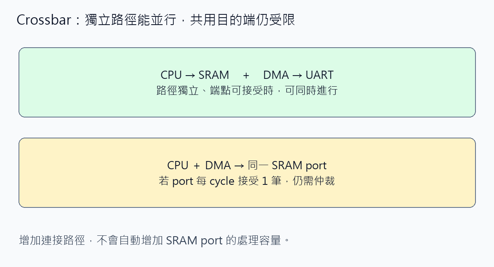
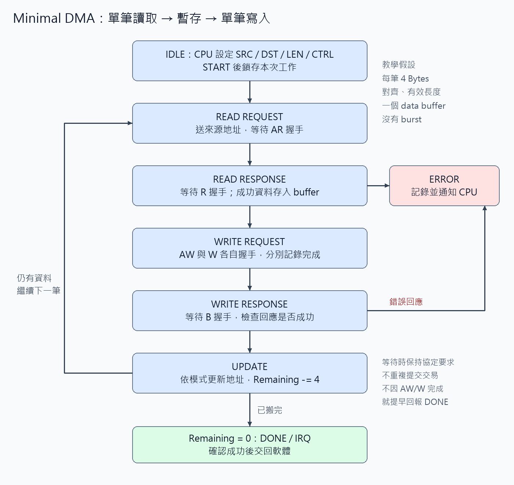
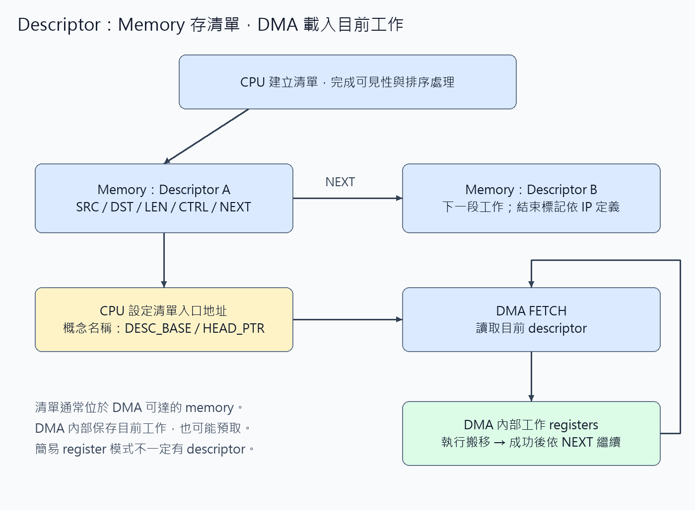

# Interconnect and Data Movement

## 1. Buses, Crossbars and Networks-on-Chip

### Protocol vs Topology

Protocol 決定交換規則，topology 決定連接結構。使用 AXI 不代表一定使用 shared bus 或 crossbar。握手與 manager / subordinate 角色見[第一單元](01_How_a_System_Works.md)。

| 結構 | 主要能力 | 主要限制 |
| --- | --- | --- |
| Shared bus | 共用路徑，結構簡單 | 不同目的端的流量仍可能爭用路徑 |
| Crossbar | 具備獨立路徑時，可同時服務不同目的端 | 同一目的 port 仍需仲裁；連線成本隨規模成長 |
| NoC | 交易封包經 router / link 分段傳送 | Hop 延遲、buffer 與路由管理；共用 link 仍會競爭 |

真實 SoC 可混用不同結構，高流量區域用 crossbar / NoC，低流量周邊透過 bridge 連接。

### Destination Bottlenecks



自訂例子：CPU 讀 SRAM、DMA 寫 UART，具備獨立路徑的 crossbar 可讓兩者並行。若兩者都存取同一個每 cycle 只能接受一筆的 SRAM port，仍只能每 cycle 接受一筆。

**增加路徑不等於增加目的端容量。** 應同時檢查路徑、仲裁與接收端的實際處理能力。

### Key Takeaways

* Protocol 描述溝通規則，topology 描述連接結構。
* Crossbar 的並行收益取決於流量是否使用不同目的端與獨立資源。
* NoC 可擴展，但不是沒有等待或共用瓶頸。
* **關鍵字：Shared Bus、Crossbar、NoC、Topology、Hop、Contention。**

### Source

* [ChipVerify — Buses, Crossbars and Networks-on-Chip](https://chipverify.com/soc-design/buses-crossbars-and-nocs)
* CPU / DMA 路徑案例與圖解為自訂教學整理。

## 2. Outstanding Transactions and Bursts

### Outstanding vs Burst

**Outstanding 描述交易尚未完成的狀態；burst 描述一筆交易包含多個 data beats。兩者可以同時成立。**

以 AXI read 為例：AR 位址已握手，但最後一個 R beat 尚未握手完成，該交易仍算 outstanding。

| 名詞 | 在數什麼？ |
| --- | --- |
| Outstanding count | 已接受、尚未完成的交易數（此處以 read 為例） |
| Burst length | 每筆交易包含的 data beats 數 |
| Beat | 資料通道的一次傳輸，依握手判斷是否完成 |

自訂例子：3 筆 read 都已接受，每筆 4 beats，尚未回傳資料，則 outstanding = 3、待回傳 = 12 beats。一筆交易先回傳 2 beats 後，outstanding 仍為 3；該交易最後一個 beat 完成後才減為 2。

### Overlap the Waiting Time

自訂理想模型：每筆單 beat read 在接受後 4 cycles 回傳，memory 每 cycle 可接受／回傳一筆，且各筆獨立。

```text
只容許 1 筆在途：A 於 T0 接受、T4 完成；B 才能接著接受。
容許 4 筆在途：  A/B/C/D 於 T0/T1/T2/T3 接受，T4/T5/T6/T7 完成。
```

A 的延遲沒有減少，但整批工作因重疊等待而提早完成。若下一筆地址依賴 A 的結果，就不能直接提前發出。

### Who Limits Outstanding Capacity?

最大容量由設計配置與沿途資源共同限制；當下數量則由實際接受及完成的交易決定。

| 位置 | 必要資源 |
| --- | --- |
| CPU / DMA | 已發出交易的追蹤紀錄與結果處理能力 |
| Interconnect / bridge | Queue、路由與回應追蹤 |
| 接收端 | Request queue 與處理容量 |

自訂例子：DMA 可追蹤 8 筆，接收端只能容納 2 筆，中間無額外緩衝。2 筆尚未完成且接收端無空間時，可以拉低 ARREADY，暫停接受下一筆。已拉高 ARVALID 的發送端需維持地址與控制，等待握手；僅將 DMA 容量改為 16 並不能解除接收端瓶頸。

若中間有 queue，它可能先收下更多交易，因此不能不看緩衝位置，就把各級容量的最小值當成整個系統的在途總數。

估算起點：`平均在途數 ≈ 完成率 × 平均在途時間`，需使用一致的計數邊界與單位。上例若目標每 cycle 1 筆、在途 4 cycles，約需 4 筆在途；真實最大容量還要考慮延遲變動、burst、相依性與成本。

### Burst and Backpressure

自訂 16 Bytes 遞增讀取：一筆地址請求，4 beats，每 beat 4 Bytes，對應 `0x2000_0000`、`0x2000_0004`、`0x2000_0008`、`0x2000_000C`。


Burst 不要求每 cycle 都完成一個 beat。第一單元的握手規則依然適用：

* RVALID = 0：尚無有效資料，接收方不使用 RDATA，進度不前進。
* RVALID = 1、RREADY = 0：維持 RVALID，且 RDATA、RRESP、RLAST 等該 beat 資訊保持穩定。
* 在 clock edge 上 RVALID 與 RREADY 同為 1，才完成該 beat。
* 最後一個 beat 即使已標示 RLAST = 1，尚未握手就仍未完成，該 read transaction 仍是 outstanding。

### Key Takeaways

* Outstanding 重疊多筆交易的等待；burst 用一筆交易描述多個 beats。
* **Burst 本身就是 transaction，可以處於 outstanding 狀態。**
* 增加在途容量不能突破接收端或資料路徑的實際容量。
* Burst 進度由握手決定，不由經過多少 cycles 決定。
* **關鍵字：Outstanding、In-flight、Burst、Beat、Backpressure、RLAST。**

### Source

* 課程章節：[ChipVerify — Outstanding Transactions and Bursts](https://chipverify.com/soc-design/outstanding-transactions-and-bursts)（本次無法讀取內文）。
* 協定依據：[Arm — An Introduction to AMBA AXI](https://documentation-service.arm.com/static/6800e9e95b1a8c5a27aa1a59)，active read transactions 與 channel transfers。
* 容量分析、時間與地址數值案例、圖解為自訂教學整理。

## 3. Arbitration and Quality of Service

### Policy & Hardware

Arbiter 決定誰取得共用資源，mux 將被選中的地址、資料與控制送到目標；回應也要送回正確來源。

| 政策 | 規則 | 注意事項 |
| --- | --- | --- |
| Fixed priority | 有請求者中優先級最高者先服務 | 低優先級可能 starvation |
| Round robin | 從 pointer 起循環搜尋有請求者 | 服務完成後推進 pointer |
| Weighted round robin | 依權重分配服務機會 | 相同 grant 次數不一定代表相同 bytes 或時間 |

以下為**自訂、非完整模組的 SystemVerilog 教學片段**，編號 0=CPU、1=DMA、2=Display。省略 mux、回應路由及完整協定控制。

Fixed priority 以 priority encoder 實現，CPU > DMA > Display：

```verilog
always_comb begin
    grant = 3'b000;
    if      (req[0]) grant[0] = 1'b1;
    else if (req[1]) grant[1] = 1'b1;
    else if (req[2]) grant[2] = 1'b1;
end
```

Round robin 多一個 pointer register。下面僅描述**新的仲裁點**如何選 candidate，以及服務完成後如何更新 pointer：

```verilog
logic [1:0] ptr;       // 下一輪搜尋的起點：0、1、2
integer idx;
always_comb begin
    candidate = 3'b000;
    for (int k = 0; k < 3; k++) begin
        idx = (int'(ptr) + k) % 3;
        if ((candidate == 3'b000) && req[idx])
            candidate[idx] = 1'b1;
    end
end

always_ff @(posedge clk or negedge rst_n) begin
    if (!rst_n)
        ptr <= 2'd0;
    else if (service_done)
        ptr <= (served_id == 2) ? 2'd0 : served_id + 1'b1;
end
```

`served_id` 是實際被服務的 requester，不能拿尚未被接受的新 candidate 代替。完整實作還需保存目前 owner，或以 buffer 固定已送出的交易；當 VALID=1、READY=0 時，不能因 candidate 改變而替換輸出資料。

`service_done` 由仲裁粒度定義：每 beat 仲裁可用實際 beat 握手；每 burst 仲裁則用相應服務邊界。**不能每 cycle 無條件輪轉**。此處不等同於所有協定的完整 transaction completion，需依介面與資源占用方式定義。

公平服務的前提是下游會前進、每次服務最終結束；round robin 無法解決永久阻塞。

### QoS Is End-to-End

QoS 要確認頻寬與等待時間符合各使用者需求，不能只看平均頻寬。

自訂例子：Display buffer 只能支撐 30 μs，卻連續 45 μs 得不到新資料，就可能 underrun。只在 interconnect 給高優先級，不能避免 memory controller 再次把它排到後面。

改善方向包括 memory controller 配合排程、buffer 快空時提高優先級、限制背景流量，以及用 aging 改善過久等待。**不一定需要增加硬體吞吐量；可能是現有容量分配不當。** 若總需求確實超過容量，才需要減少需求或增加資源，QoS 本身不創造頻寬。

自訂公平性例子：CPU 每次 4 beats、DMA 每次 16 beats，若以整個 burst 輪流各一次，兩者 grant 次數相同，但資料量不是各半。

### Key Takeaways

* Fixed priority 可用優先編碼器；round robin 另需 pointer 與實際服務狀態。
* 指標在定義的服務邊界更新，且等待中的有效輸出必須保持穩定。
* QoS 需沿路徑配合，並檢查最差等待，不只平均頻寬。
* **關鍵字：Arbiter、Priority Encoder、Round Robin、Pointer、Starvation、QoS、Aging。**

### Source

* [ChipVerify — Arbitration and Quality of Service](https://chipverify.com/soc-design/arbitration-and-qos)
* Verilog、服務邊界說明與數值案例為自訂教學整理。

## 4. DMA Engines

### Minimal DMA Hardware

DMA 的用途、CPU 仍可自行存取資料，以及 DMA 完成不代表 UART 已送完，見[第一單元](01_How_a_System_Works.md)。以下以 flow chart 說明自訂簡化硬體。

假設：單 channel、每次 4 Bytes、地址與長度對齊、長度為正且為 4 的倍數、一個 32-bit buffer；沒有 burst、多筆 outstanding 或 descriptor。輸入條件不符需拒絕或另定義處理方式。



硬體核心：設定 registers、FSM、current SRC / DST、remaining bytes、data buffer，以及 bus master interface。CPU 只設定一次，硬體反覆執行讀取、暫存、寫入與地址更新。

使用 AXI 時，AW 和 W 必須獨立追蹤握手；兩者完成後仍要等待 B response 並檢查結果，才將本 word 計為成功。Read response 出錯也需進入錯誤處理。

成功後依模式更新地址，remaining 減 4；若還有資料就繼續，全部成功才回報 DONE。讀寫等待不應造成重複提交。完整產品也需定義 timeout、reset、取消與錯誤後已完成部分的語義。

### Address Mode & Peripheral Flow Control

自訂 memory → UART TXDATA 案例：SRC 隨資料位置遞增，DST 固定在同一個 FIFO 入口。依 UART 要求使用合適的傳輸寬度；上述 4-byte memory copy 模型不能不加適配就假設能寫任意 UART。

DMA 必須遵守周邊的流量控制，例如 DMA request 或 bus backpressure，不能假設 FIFO 永遠有空間。

### Descriptor: Work List and Current State



Descriptor 像 CPU 寫給 DMA 的格式化待辦事項。支援此模式的 DMA 通常從可達 memory 讀取清單，再將目前工作的 SRC、DST、LEN、CTRL、NEXT 等內容載入內部 registers / buffer；欄位依 IP 而異。

| 模式 | CPU 如何交付工作 |
| --- | --- |
| 直接設定 | 寫 SRC / DST / LEN / CTRL，再啟動 |
| Descriptor chain | 準備 memory 清單，設定第一份 descriptor 的地址，再啟動 |

第一份地址的 register 可概念性稱為 `DESC_BASE` 或 `HEAD_PTR`，不是通用固定名稱；依 IP 手冊設定。Descriptor-based DMA 不是只把第一段的 SRC / DST / LEN 寫入就自動知道清單在哪。

有些 DMA 會預取下一份 descriptor；有些簡易 DMA 完全沒有 descriptor 功能。

### Reachability, Permissions and Ownership

CPU / DMA 的存取規劃要區分：有沒有路徑、是否授權、操作模式是否相容。

自訂設計例子：

| 區域 | CPU | DMA | 設計理由 |
| --- | --- | --- | --- |
| 共用 SRAM | 可 | 可 | CPU 準備、DMA 搬移 |
| UART TXDATA | 可 | 可 | 支援直接傳送及 DMA |
| 系統 reset 控制 | 授權軟體可 | 禁止 | 防止 DMA 誤觸控制 |
| 未提供外部入口的 CPU 本地記憶體 | 可 | 無路徑 | 連接結構限制 |

重疊表示不同 master 可達同一目標，不是地址區域衝突。權限也可依安全屬性、privilege、master ID 與範圍判斷，不是 CPU 存取一律允許。CPU 與 DMA 的地址視圖可能不同，需使用 DMA 可理解的地址。

### Cache Visibility and Buffer Handoff

自訂例子：CPU write-back cache 裡是新值 99，memory 還是舊值 10。Non-coherent DMA 直接讀 memory 就可能得到 10。

* **Clean：** 寫回 dirty data。CPU 準備資料供 DMA 讀取時，要依平台要求使新資料可見，再完成必要排序並啟動。
* **Invalidate：** 使 cache 副本失效；不能代替 clean 把 CPU 新資料交給 DMA。單純丟棄 dirty line 可能遺失尚未寫回的修改。
* DMA 寫入 buffer 後，CPU 的舊 cache 副本也需依平台流程處理；交給 DMA 前同樣要避免 dirty lines 後續寫回覆蓋新結果。

實際操作使用平台 DMA / cache API。Cache maintenance 與 memory ordering 不是同一件事；coherent 路徑也仍需遵守軟體排序與 ownership 規則。

```text
CPU 準備資料與 descriptor
 → 依平台同步，使 DMA 可見
 → 交給 DMA，CPU 暫不修改該範圍
 → 等待完成並檢查成功／錯誤
 → 依平台同步後，CPU 才重用或讀取結果
```

### Key Takeaways

* 簡易 DMA = registers + FSM + buffer + bus master interface。
* 地址增量、寬度與流量控制需符合來源及目的端。
* Descriptor 清單通常在 memory，DMA 載入目前工作；CPU 提供清單入口地址。
* CPU 新資料供 non-coherent DMA 讀取時，clean 與 invalidate 不能互換。
* 完成、可見性與 ownership 都要定義，不能太早重用 buffer。
* **關鍵字：DMA FSM、Descriptor、Scatter-Gather、Address Mode、Reachability、Clean、Invalidate、Ownership。**

### Source

* [ChipVerify — DMA Engines](https://chipverify.com/soc-design/dma-engines)
* [Microchip — Arbitration](https://onlinedocs.microchip.com/oxy/GUID-F5813793-E016-46F5-A9E2-718D8BCED496-en-US-15/GUID-007A8CB4-4F8E-40E7-A707-4EDD5C81D726.html)：從 SRAM 取得 descriptor 並存入內部預取狀態的實例。
* [Arm DMA-250 Technical Reference Manual](https://documentation-service.arm.com/static/66f6b5251669c0388dca6bd4)：安全與 privilege 存取限制實例。
* 簡化硬體、flow charts、存取矩陣與案例為自訂教學整理，不代表特定 IP 的完整設計。
