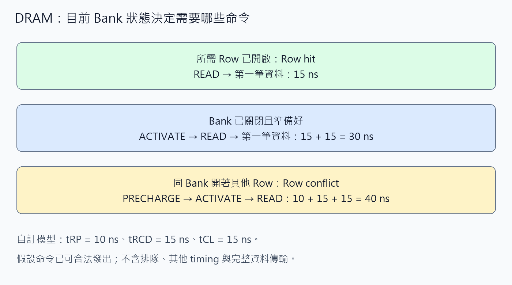
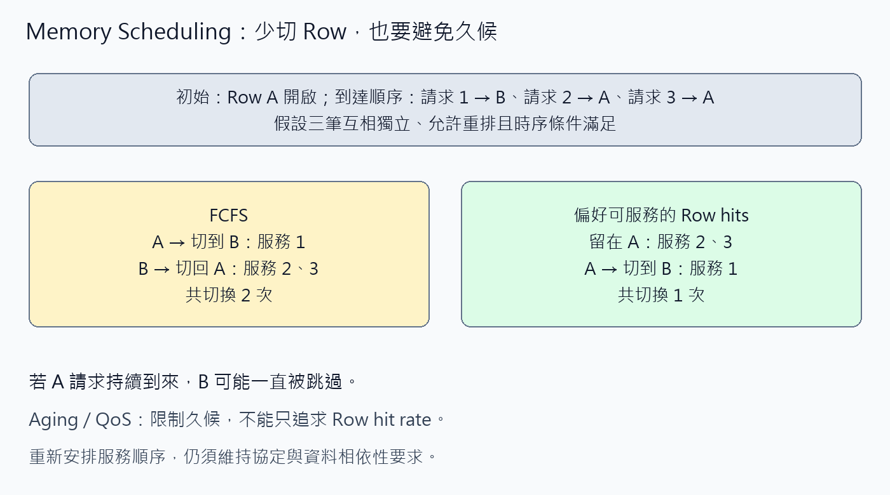
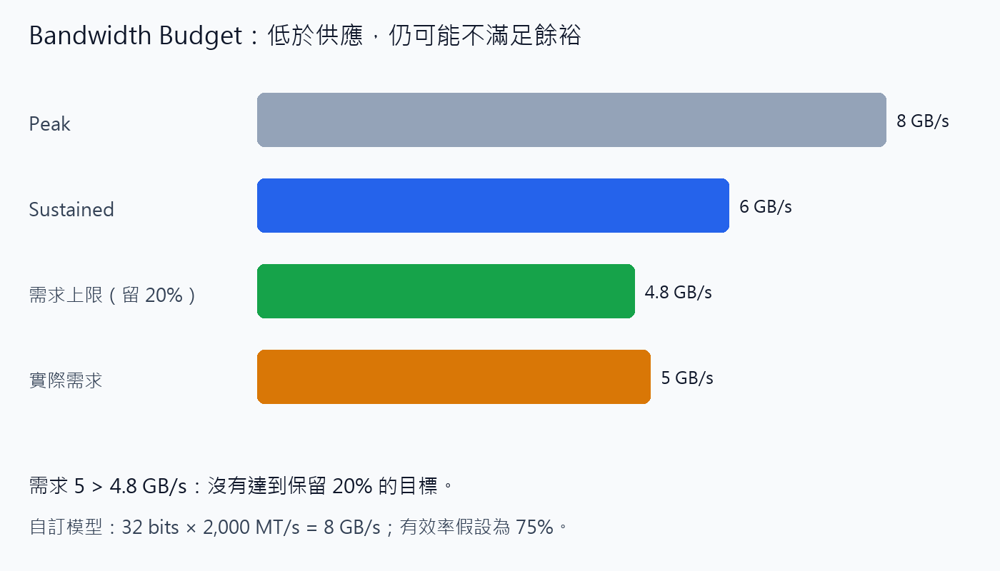
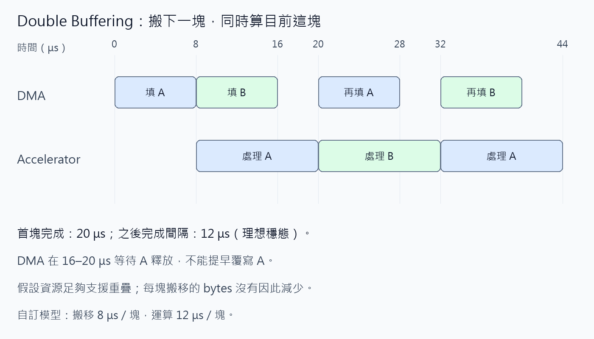

# The Memory Subsystem

## 1. DRAM Organization

### Channel, Rank, Bank, Row and Column

SRAM / DRAM 的用途見[第一單元](01_How_a_System_Works.md)。本章聚焦 DRAM 內部組織如何影響存取。

| 層次 | 意義 |
| --- | --- |
| Channel | 一組記憶體介面，提供傳輸資源 |
| Rank | 配合回應的一組 DRAM chips，形成所需資料寬度 |
| Bank | 可分別管理 row 狀態的陣列 |
| Row / Column | 在 bank 內選取資料的位置 |

不同 banks 可重疊部分內部操作，但不代表各自擁有獨立的外部資料線；共用 channel 的資料傳輸仍受該介面容量限制。

### Row Buffer and Commands

DRAM 儲存的電荷需要定期 refresh。ACTIVATE 啟動 row，sense amplifiers 感測並恢復資料；這些電路形成 row buffer，再由 column 存取選擇資料。**Row buffer 在 DRAM 端，不是 CPU cache。**

PRECHARGE 關閉目前 row 並將 bitlines 準備好，供下一次 ACTIVATE 使用；「關閉」是這一步的效果，不是需要另外插入的一個通用 CLOSE 命令。資料恢復不是到 PRECHARGE 才開始，仍需遵守相關時序。



### Simplified First-Data Latency

自訂例子：tRP = 10 ns、tRCD = 15 ns、tCL = 15 ns。

| 起始狀態 | 主要命令 | 到第一筆資料的簡化延遲 |
| --- | --- | --- |
| 所需 row 已開啟：row hit | READ | tCL = 15 ns |
| Bank 已關閉且準備好 | ACTIVATE → READ | tRCD + tCL = 30 ns |
| 同 bank 開著另一個 row：row conflict | PRECHARGE → ACTIVATE → READ | tRP + tRCD + tCL = 40 ns |

假設第一個命令已可合法發出，忽略其他限制與等待。這不是完整 CPU load latency，也未計入 queue、interconnect、refresh 或整段資料傳輸；實際還有其他 DRAM timing 要求。

### Address Mapping

自訂例子：兩筆都落在同 bank 不同 rows，可能要切 row；若分散到不同 banks，則有機會重疊部分準備工作。Controller 的 address mapping 決定地址如何對應 channel / rank / bank / row / column，因此要依實際存取模式評估。

### Key Takeaways

* DRAM 延遲取決於 bank / row 狀態，不是固定常數。
* Row conflict 的主要順序為 PRECHARGE → ACTIVATE → READ。
* Bank 並行不等於外部資料介面完全獨立。
* **關鍵字：Channel、Rank、Bank、Row Buffer、ACTIVATE、PRECHARGE、Row Hit、Row Conflict。**

### Source

* [ChipVerify — DRAM Organization](https://chipverify.com/soc-design/dram-organization)
* 時序數值、存取案例與圖解為自訂教學整理。

## 2. Memory Controllers and Scheduling

### Controller vs PHY

```text
CPU / DMA → Interconnect
 → Controller：queue、地址映射、bank 狀態、timing、scheduler
 → PHY：高速實體訊號的驅動與取樣
 → DRAM
```

Controller 把存取要求轉成合法 DRAM 命令，安排 refresh，並依協定回傳資料及回應；PHY 處理實體介面。

### Scheduling and Row Locality

FCFS 依到達順序服務。FR-FCFS 優先考慮可發出的工作，典型策略偏好可服務的 row hits；仍須符合 timing、ordering 與 QoS。



自訂例子：目前 Row A 開啟，queue 順序為 B、A、A，且三筆獨立、允許重排。

* FCFS：切到 B，服務第一筆，再切回 A 服務其餘兩筆。
* 偏好 row hits：先完成 A、A，再切到 B，少一次 row 切換。

若新的 A 請求不斷到來，B 可能 starvation。可用 aging 提高久候請求的優先程度，並配合有界服務政策。QoS 與 round robin 等原理見[第四單元](04_Interconnect_and_Data_Movement.md)，此處不重複展開。

### Page Policy

這裡的 page 指 DRAM row 管理，不是作業系統的 virtual-memory page。

| 政策 | 行為與取捨 |
| --- | --- |
| Open-page | 留 row 開啟，期待後續 row hit；換 row 時可能先需 precharge |
| Closed-page | 存取後安排關閉，可能提前完成 precharge，但放棄後續 row hit |
| Adaptive | 依存取模式調整，增加判斷與狀態管理 |

沒有一種政策對所有流量都最佳；closed-page 也不代表實際每筆 latency 完全相同。

### Write Queue and Correct Data

自訂例子：DRAM[X] = 10，write queue 有尚未寫入的 X = 99；接著有一筆**必須看到這次寫入結果**的 read X。

```text
Read X
  ├─ 從 write queue 取得符合順序的最新資料 → 回傳 99
  └─ 等相關 write 完成，再讀 DRAM        → 回傳 99
```

不能直接回傳舊值 10。實作還需處理部分 byte writes、重疊範圍與多筆寫入的順序。重新排程可以改變執行安排，不能改變規定的資料結果。

### Key Takeaways

* Controller 排程並遵守 DRAM 時序；PHY 處理實體訊號。
* Row-hit 排程可能提升效率，但需防止其他請求長期被跳過。
* Page policy 決定何時保留或關閉 row；scheduler 決定服務順序。
* Read 要考慮待處理 writes，維持要求的資料順序。
* **關鍵字：Memory Controller、PHY、FCFS、FR-FCFS、Page Policy、Write Queue、Ordering。**

### Source

* [ChipVerify — Memory Controllers and Scheduling](https://chipverify.com/soc-design/memory-controllers)
* A/B 排程、write queue 數值案例與圖解為自訂教學整理。

## 3. Memory Bandwidth Budgets

### Count at the Same Boundary

Bandwidth budget 針對每個使用情境，將同時運作的 IP 所需 DRAM 流量加總，與可持續供應比較。基本 bandwidth 原理見[第一單元](01_How_a_System_Works.md)，QoS 與等待上限見[第四單元](04_Interconnect_and_Data_Movement.md)。

本章計數位置是 DRAM 介面，不是所有 CPU / accelerator 內部存取。Cache hit 若沒有到 DRAM，就不計為一次 DRAM read。

自訂例子：A 每秒寫入 200 MB 中間結果，B 再完整讀一次，合計 `200 + 200 = 400 MB/s`。若透過片上 buffer 直接交接，且不需 DRAM 副本，可省掉這部分 400 MB/s；不是省掉片上搬移本身。

### Peak, Sustained and Margin



自訂例子：32-bit 介面、2,000 MT/s、假設有效率 75%。使用十進位單位：1 GB = 10^9 Bytes。

```text
Peak = 2,000 × 10^6 transfers/s × 4 Bytes/transfer = 8 GB/s
Sustained estimate = 8 × 75% = 6 GB/s
保留供應的 20% 餘裕：需求上限 = 6 × 80% = 4.8 GB/s
```

**MT/s 已表示每秒傳輸次數，不因 DDR 再乘 2。** 75% 是此例的估計值，應由實際流量與模型驗證，不是通用固定效率。

若需求是 5 GB/s，雖未超過 6 GB/s，仍不符合 20% 餘裕目標。餘裕以 sustained supply 為分母：`(6 - 5) / 6 ≈ 16.7%`。

### Check the Traffic Pattern

Row conflicts、refresh、讀寫切換與排程會影響 sustained supply。平均需求通過後，還需檢查突發、最長等待及 buffer 能否支撐。

需求過高時，可增加 channel / 介面能力，也可透過資料重用、壓縮或直接交接減少 DRAM 流量。降低一次 DRAM 往返通常同時減少傳輸能耗，但仍需評估新增片上資源成本。

### Key Takeaways

* 在相同邊界統計流量，寫入與讀回都要算，單位保留 Bytes/s。
* 以實際流量的 sustained supply 比較，不只引用 peak。
* 明確定義餘裕分母，並檢查平均值之外的突發與 deadline。
* **關鍵字：Bandwidth Budget、Peak、Sustained、MT/s、Efficiency、Margin、Traffic Reduction。**

### Source

* [ChipVerify — Memory Bandwidth Budgets](https://chipverify.com/soc-design/memory-bandwidth-budgets)
* 數值與流量案例、圖解為自訂教學整理。

## 4. On-Chip SRAM, Scratchpads and System Caches

### Technology vs Role

**SRAM 是儲存技術；TCM、scratchpad、cache 描述架構或管理方式，不是互斥的儲存技術。** Cache / TCM 基礎見第一單元，此處只補充關係與系統用途。

| 名稱 | 強調什麼 | 常見用途 |
| --- | --- | --- |
| TCM | 與 CPU 緊密連接的存取路徑 | 關鍵程式、stack、即時資料 |
| Scratchpad | 由軟體或明確搬移流程安排內容，不由 cache 自動替換 | 分塊輸入、輸出與中間結果 |
| System cache | 硬體管理 hit、fill、replacement，服務接入的多個 IP | 減少 DRAM 流量與延遲 |

TCM 通常可視為緊密連接 CPU 的 scratchpad 類記憶體。兩者都可能使用 SRAM；內容均可在執行時更新。DMA 依配置執行搬移，不代表 DMA 自動決定整個程式的資料配置。

**DMA 能否存取 TCM，取決於對外入口、interconnect 路徑與權限。** 不能只憑名稱認定一定不能存取，也不能只憑 TCM / scratchpad 名稱保證固定一個 cycle；端口、仲裁與實作都會影響時間。

### Scratchpad Reuse

自訂例子：同一塊 16 KB 輸入被完整讀取 4 次。假設原本無 cache / buffer 重用，四次從 DRAM 讀需 64 KB；先搬到 scratchpad 再重用，輸入 DRAM read 可減為 16 KB。輸出及其他流量另算。

軟體或控制流程要安排搬入、運算及空間重用，避免使用尚未搬完或已被覆寫的內容。

### Double Buffering



自訂例子：DMA 搬一塊需 8 μs，加速器算一塊需 12 μs。

```text
串行：每塊 8 + 12 = 20 μs
雙緩衝：理想穩態每塊 max(8, 12) = 12 μs
```

假設 DMA 與加速器可同時使用所需資源，且忽略啟動、收尾與其他瓶頸。第一塊仍須先搬入再計算，不能把 12 μs 當成所有情況的單塊端到端延遲。

A 被加速器使用時，DMA 可填 B；加速器切到 B 後，才可安全重填 A。**Double buffering 隱藏搬移時間，不會自動減少所搬的 bytes。**

### System Cache and Interference

System cache 可讓連接到它的多個 IP 利用自動資料重用，但哪些路徑經過它由 SoC 決定。

自訂例子：CPU 反覆使用小工作集，GPU 大量串流資料只使用一次。若 GPU 不斷配置新 cache entries，可能擠掉 CPU 的有用內容。可用容量 / ways 分配，或對特定串流採取不配置新 entries 的策略，減少干擾。

System cache 不代表整條 DMA 路徑自動 coherent；仍需確認與 CPU 私有 caches 之間的硬體連接與協定。片上 SRAM 也有面積、容量與功耗成本，不是越大一定越好。

### Key Takeaways

* TCM 強調 CPU 連接，scratchpad 強調明確內容管理，兩者可重疊。
* 資料重用可減少 DRAM bytes；double buffering 則主要重疊時間。
* 雙緩衝需遵守 ownership，不能覆寫仍在使用的 buffer。
* System cache 效果依 locality 與共享競爭而定，不自動保證 coherence。
* **關鍵字：SRAM、TCM、Scratchpad、Reuse、Double Buffering、System Cache、Partitioning。**

### Source

* [ChipVerify — On-Chip SRAM, Scratchpads and System Caches](https://chipverify.com/soc-design/sram-scratchpads-and-system-caches)
* TCM / scratchpad 分類說明、雙緩衝數值及圖解為自訂教學整理。
