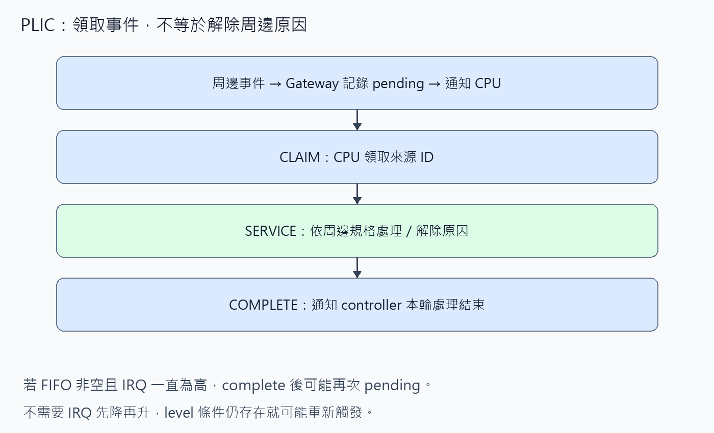
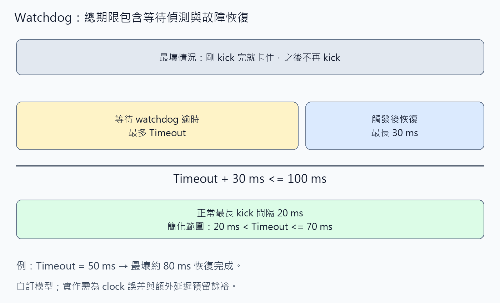

# Interrupts, Timers and Multicore

## 1. Interrupt Controllers

### Pending, Enable, Priority and Target

Interrupt 基礎見[第一單元](01_How_a_System_Works.md)，連線驗證見[第三單元](03_Building_with_IP.md)。Controller 收集來源，依 pending、enable / mask、priority 與 target 配置通知 CPU。

**PLIC = Platform-Level Interrupt Controller（平台層級中斷控制器）。** 以下以 RISC-V PLIC 類型的 claim / complete 說明，不代表所有架構都使用相同介面。

### Claim → Service → Complete



Claim 取得來源 ID 並領取 pending 事件；handler 依周邊規格處理原因，再 complete 告知 controller 本輪處理結束。**Controller pending 狀態與周邊事件原因是不同層次。**

自訂例子：UART 的 IRQ 在 RX FIFO 非空時維持 1。若 claim 後不讀 FIFO，直接 complete，IRQ 可能一直保持高，而不是先降再升；gateway 重新允許接收後，可再次形成 pending。

處理方式依周邊語義，例如讀走資料使該條件解除，必要時確認相關操作已生效，再 complete。不能把所有來源都當成寫 1 清除的 status bit。

### Level, Edge and Event Recording

* Level-sensitive：條件存在時，訊號維持有效。
* Edge-sensitive：指定跳變代表事件。
* 周邊可先鎖存內部事件，再以 level IRQ 輸出；以實際介面行為設定。
* Pending bit 不是無限事件計數器。連續事件是否合併、計數或遺失，依硬體規格。

### Priority Is Not Automatic Preemption

自訂例子：背景 handler 需 40 μs，音訊要求 10 μs 內開始處理。若不允許 nesting，音訊在背景 handler 剛開始時到達，可能等近 40 μs；只提高 priority 不足以保證期限。

可縮短 handler，把耗時工作移到一般 task，或依架構配置安全的 nesting / 其他 CPU 路由。延後工作能縮短 ISR，但仍需確認完整工作本身的 deadline。

### Key Takeaways

* Claim、周邊原因解除、complete 是不同動作。
* Level IRQ 未解除時，complete 後可能立即再次 pending。
* Priority 不自動保證正在執行的 handler 可被打斷。
* **關鍵字：PLIC、Pending、Mask、Priority、Claim、Complete、Level、Edge、Nesting。**

### Source

* [ChipVerify — Interrupt Controllers](https://chipverify.com/soc-design/interrupt-controllers)
* UART 條件、handler 時間案例與圖解為自訂教學整理。

## 2. Timers and Watchdogs

### Time Base vs CPU Cycles

Counter / Compare 原理見第三單元。本章聚焦時間基準與 watchdog。

自訂計算：固定等待 10,000 CPU cycles，假設區間內頻率不變。

```text
100 MHz：10,000 / (100 × 10^6) s = 100 μs
 50 MHz：10,000 / ( 50 × 10^6) s = 200 μs
```

Timeout 應依固定速率、已知頻率的 time base，或能維持一致時間的設計；僅有「另一個 clock」仍不夠，需確認速率不受 CPU 調頻影響。睡眠期間需要計時或喚醒，也要確認相關 clock / power 仍有效。

### Watchdog and Proof of Progress

Watchdog 要求軟體在期限內合法 kick / feed；逾時觸發規定的中斷或 reset 等處置。它監督服務動作，不會直接理解程式是否正確。

自訂例子：主工作 deadlock，但 timer ISR 每 5 ms kick，timeout 為 50 ms。只要 ISR 繼續執行，watchdog 就可能一直不逾時。

較好的條件是**所有受監督的關鍵任務，在本輪都有新的有效進展**，才 kick；不能只確認某個任務完成，也不能重複使用上輪的 progress flag。進展紀錄需正確同步。

### Timeout Budget



自訂模型：正常最長 kick 間隔 20 ms；故障到恢復完成的總期限 100 ms；逾時後恢復流程最長 30 ms。

```text
避免誤判正常工作：Timeout > 20 ms，並留餘裕
故障後及時恢復：  Timeout + 30 ms ≤ 100 ms
所以：           20 ms < Timeout ≤ 70 ms
```

最壞情況是假設軟體剛 kick 完就故障，之後不再合法 kick，因此要等滿整個 Timeout 才觸發處置。100 ms 包含偵測等待與恢復，不是只給 watchdog 的等待額度。

| Timeout | 最壞恢復完成時間 | 是否符合此模型 |
| --- | --- | --- |
| 50 ms | 50 + 30 = 80 ms | 是 |
| 80 ms | 80 + 30 = 110 ms | 否 |

70 ms 是忽略誤差時的數學上限；實際需預留 clock 誤差、排程抖動、reset 與傳遞延遲，不宜直接卡邊界。

### Robustness Features

| 機制 | 用途 |
| --- | --- |
| Window mode | 太早或太晚 kick 都可能視為異常 |
| 特定寫入序列 | 降低意外寫入完成 kick 的機會 |
| 啟用後鎖定 | 限制錯誤程式隨意停用 watchdog |
| 獨立 clock | 降低主 clock 停止時監督也停止的風險 |
| Reset cause 記錄 | 開機後辨識此次 reset 原因 |

Window mode 不取代進展檢查；這些機制也不保證偵測所有故障。

### Key Takeaways

* CPU cycles 換算時間需要頻率；調頻後不能沿用固定 cycle 數代表同一時間。
* Kick 應依關鍵工作的本輪進展，而不是 ISR 仍有執行。
* 故障期限包括偵測與恢復，timeout 同時受正常間隔與總期限限制。
* **關鍵字：Time Base、Watchdog、Kick、Progress、Timeout、Window Mode、Reset Cause。**

### Source

* [ChipVerify — Timers and Watchdogs](https://chipverify.com/soc-design/timers-and-watchdogs)
* Cycle 換算、timeout 與進展案例、時間軸為自訂教學整理。

## 3. Multicore Integration and Coherent Interconnects

待學習。
