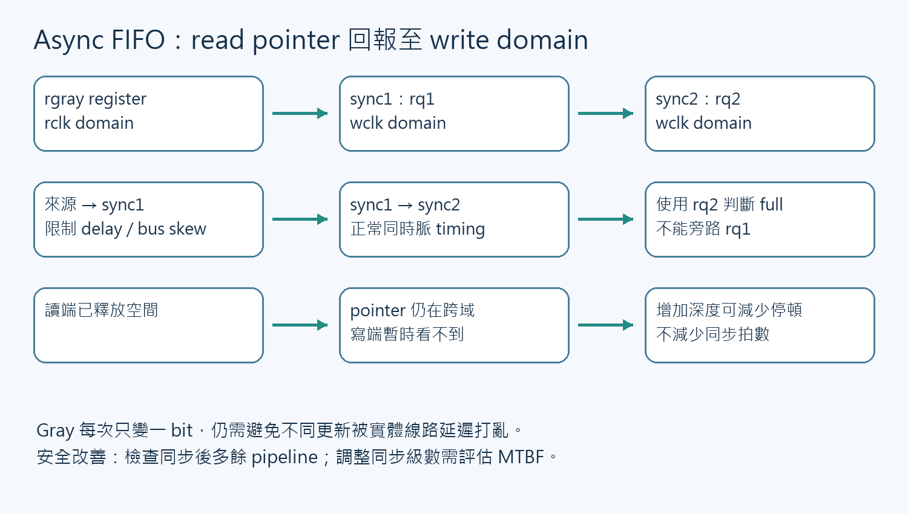
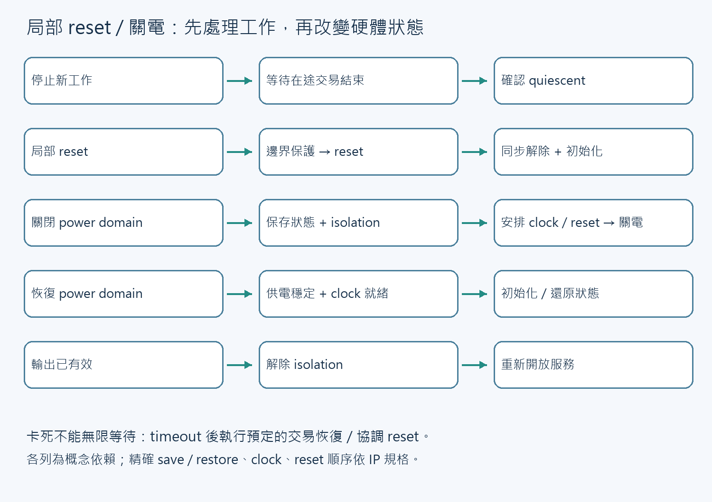

# Clocks, Resets and Power

## 1. Clock Architecture and CDC

### Clock Relationships

Reference clock 可經 PLL、divider 產生 CPU、interconnect 和周邊時脈；always-on timer 需確認休眠時仍有有效時脈。不同頻率不必然代表 asynchronous：若相位與頻率關係已知、且正確建模，可用 STA 分析；無法依賴固定關係的 crossing 才需適當 CDC 設計。

CDC 基礎見[第一單元](01_How_a_System_Works.md)，本章補充實作與實體限制。

| 傳遞內容 | 常用方式與限制 |
| --- | --- |
| 持續維持的單一 bit | 多級 synchronizer 降低 metastability 傳出的機率 |
| 短暫事件 | 握手或合適的 toggle 協定；必須限制事件間距 |
| 多 bit 控制資料 | 穩定資料配合握手，不能各 bit 獨立同步後直接拼接 |
| 連續資料流 | Async FIFO，搭配 full / empty 與 backpressure |

例如 2 ns pulse 進入週期 10 ns 的 domain，2FF 仍可能完全沒取樣到；降低 metastability 風險不等於保證接收到事件。

### Async FIFO and Conservative Flags

資料存於雙埠儲存體；read / write pointer 各自在自己的 domain 更新，轉成 Gray code 後跨域。對方看到的是延後的 pointer，因此 full / empty 的解除可能較保守。有限深度不能解決長期平均寫入率大於讀出率，仍需 backpressure。



### Registered Gray Pointer: RTL Fragment

以下是示意片段，省略 storage、full / empty 產生與完整 reset 協定；不是可直接使用的 FIFO。Reset release 需各 domain 安全處理，並協調 FIFO 狀態。

```systemverilog
// 每次成功讀取，binary pointer 前進一步。
assign rbin_next  = rbin + (r_en && !r_empty);
assign rgray_next = (rbin_next >> 1) ^ rbin_next;

always_ff @(posedge rclk or negedge rrst_n)
  if (!rrst_n) begin
    rbin  <= '0;
    rgray <= '0;
  end else begin
    rbin  <= rbin_next;
    rgray <= rgray_next;
  end

// Attribute 語法與效果需依工具確認。
(* ASYNC_REG = "TRUE" *) logic [PTR_W-1:0] rq1, rq2;
always_ff @(posedge wclk or negedge wrst_n)
  if (!wrst_n) begin
    rq1 <= '0;
    rq2 <= '0;
  end else begin
    rq1 <= rgray;
    rq2 <= rq1;
  end
// 寫端判斷使用 rq2，不使用 rq1。
```

先 register Gray code，避免 binary-to-Gray 組合轉換的 glitch 直接跨域。相鄰合法更新只改一 bit，前提是 pointer 每次只前進一步；目的端可能跳過中間狀態，不要求連續兩次取樣值也只差一 bit。

### Why Gray Still Needs Timing Constraints

自訂反例：來源每 2 ns 最多更新一次。

| 來源更新 | 改變的 bit | 路徑延遲 | 抵達第一級 D 的時間 |
| --- | --- | --- | --- |
| t = 0：000 → 001 | bit 0 | 3 ns | 3 ns |
| t = 2：001 → 011 | bit 1 | 0.2 ns | 2.2 ns |

接收端輸入會先看到 010，再變成 011，更新順序被線路延遲打亂。Gray 的 RTL 性質不足以保證實體電路保持相同順序。

約束重點是 **source Gray register → destination 第一級 synchronizer**。依來源最短更新間隔與實體餘裕限制延遲／skew；兩個方向要各自分析，不能一律用較慢接收時脈的週期。

以下為 Vivado XDC 示意，假設來源最快 2 ns 更新一次，教學上選 1.5 ns 預算。數值與 netlist 名稱必須依設計調整，並非通用 signoff 設定。

```tcl
# 示意 synthesized pin 名稱；確認集合涵蓋所有 pointer bits。
set gray_q [get_pins -hierarchical -regexp {.*u_fifo/rgray_reg\[[0-9]+\]/Q}]
set sync1_d [get_pins -hierarchical -regexp {.*u_fifo/rq1_reg\[[0-9]+\]/D}]
set_max_delay -datapath_only 1.5 -from $gray_q -to $sync1_d
set_bus_skew 1.5 -from $gray_q -to $sync1_d
```

* `set_max_delay -datapath_only` 限制個別資料路徑的延遲；`set_bus_skew` 限制各路徑抵達時間的相對差異。語法依工具而異，並非所有 SDC 工具都支援 `set_bus_skew`。
* 第一級 → 第二級是同一個目的 clock domain，保留正常 timing analysis；靠近放置、避免中間組合邏輯，讓 metastability 有足夠 settling time。
* Vivado 的廣泛 `set_clock_groups -asynchronous` 或 `set_false_path` 可能蓋掉 max-delay 約束。需安排適當的逐路徑例外並檢查 ignored / overridden exceptions，不能認為寫入檔案就生效。
* 檢查集合是否為空、bit 數是否完整，再看 post-route timing、bus-skew 與 CDC 報告。Bus-skew assertion 與一般 timing exception 的作用不同。

### Reducing Full-Release Delay

讀端釋放空間 → read pointer 更新 → 寫端 sync1 → sync2 → full 判斷 → 寫入重新允許。

| 方法 | 效果與限制 |
| --- | --- |
| 消除 sync2 後多餘 pipeline | 可降低 flag / 控制延遲；仍需保持同步安全與時序正確 |
| 檢討 synchronizer 級數 | 例如 3 級改 2 級，必須先以元件、頻率與 settling time 評估 MTBF |
| 增加 FIFO 深度或 staging buffer | 可吸收流量突發、減少 full 停頓；不縮短 pointer 跨域拍數 |
| 更換為其他已驗證架構 | 屬於架構重設計，需另外驗證 CDC 與 flag 行為 |

**不能直接使用第一級輸出去提早解除 full。** 第一級可能 metastable；不是說它經常發生，而是它尚未提供設計要求的可靠性。也不能憑猜測讀端將釋放空間就先寫入。

面試回答可先區分「減少回報延遲」與「降低滿載停頓」：先檢查安全同步之後是否多了控制拍數，再評估深度與流量；若調整同步級數，需提出 MTBF 依據。

### Clock Gating and Switching

直接用 `clk & enable`，若 enable 在 clock 高電位時改變，可能產生短脈衝。ASIC 使用適當 ICG，FPGA 使用專用 clock / enable 資源；切換 clock source 也需適當 glitch-free 機制。

### Key Takeaways

* Synchronizer、事件不遺失、多 bit 一致性，是不同設計問題。
* Gray code 需要正確 RTL，也需要來源到第一級的實體延遲／skew 保證。
* Full 保守解除是可靠性代價；增加深度改善停頓，不改變同步拍數。
* **關鍵字：Clock Domain、CDC、Metastability、Gray Code、Bus Skew、MTBF、Async FIFO、ICG。**

### Sources

* [ChipVerify — Clock Architecture and CDC](https://chipverify.com/soc-design/clock-architecture-and-cdc)
* [AMD — Bus Skew Constraints](https://docs.amd.com/r/2022.2-English/ug903-vivado-using-constraints/About-Bus-Skew-Constraints)
* [AMD — Overridden Max Delay Datapath Only](https://docs.amd.com/r/2022.2-English/ug906-vivado-design-analysis/TIMING-24-Overridden-Max-Delay-Datapath-Only)
* RTL、約束、數值案例與圖解為教學示意，需依實際設計與工具驗證。

## 2. Reset Architecture and Reset Domain Crossings

### Reset Scope and Dependencies

Reset assert / release 基礎見[第一單元](01_How_a_System_Works.md)。本章聚焦局部 reset 與跨區塊影響。

Reset domain 是一起被同一 reset 控制的暫存器集合，與 clock domain 不必一一對應。規格需定義每種 reset 的作用範圍、保留狀態與解除依賴。例如 watchdog reset 後仍須讀取原因，reset-cause register 就必須能保留該次原因；debug reset 也可能保留 debug 連線。

### Same Clock Can Still Have RDC

自訂例子：A、B 使用相同 clock，A 可以獨立 asynchronous reset，B 持續運作。A 的 valid 直接送到 B。

* 電氣／時序風險：A assert reset 時，valid 可在任意時間變化。若接近 B 的取樣邊緣，B 可能 metastable 或取到不預期的值。
* 功能／協定風險：A 清掉工作記錄，但 B 還在等回覆，或仍會送回舊工作的 response。

**同步解除 A 的 reset，不能消除 assert reset 對 B 的影響。** 只等交易完成也不自動證明所有 crossing 安全；還需依訊號語義安排隔離、同步、握手或協調 reset 範圍，並檢查 RDC。

### Quiesce Before Local Reset



可控制的局部 reset：停止新工作 → 等待在途交易結束 → 確認 quiescent → 啟用適當邊界保護 → reset → 等 clock 與相依資源就緒 → 同步解除並初始化 → 重新開放服務。

Quiescent 表示已無尚未交代完的工作；不能只看 IP 不再發出新 request。DMA 的寫入尚未收到 B response，就仍可能有在途交易。

若硬體已卡死，不能無限等待 drain。可設 timeout / watchdog 觸發預定恢復流程，但**重啟的範圍與協定處置必須完整**：例如由支援的 bus recovery 機制完成錯誤處置，或協調重置相關區塊。若只 reset DMA，而互連仍保留舊交易，問題可能依舊存在。不能任意憑空取消 AXI 交易或把所有輸出壓 0 就當作完成。

### Reset Data vs Control State

FIFO 可透過 pointer、empty、valid 的初始化，避免舊 storage 內容被當作有效資料，不一定要 reset 每一個資料 bit。這要求所有使用路徑都遵守有效性規則。機密資料的安全清除是另一項需求，不能用 empty 取代。

### Key Takeaways

* 同 clock 不代表沒有 RDC；asynchronous reset assertion 也可能引入非同步變化。
* 局部 reset 同時涉及 crossing 安全與 transaction 生命週期。
* Watchdog 是恢復觸發來源；系統仍須定義能收拾在途工作的恢復範圍。
* **關鍵字：Reset Domain、RDC、Quiescent、Drain、Isolation、Reset Cause、Recovery。**

### Source

* [ChipVerify — Reset Architecture and Reset Domain Crossings](https://chipverify.com/soc-design/reset-architecture-and-rdc)
* A / B、DMA 與恢復情境為自訂教學分析。

## 3. Power Domains and Power Management

### Clock Gating vs Power Gating

Clock gating 的 glitch 防護見本單元第 1 章。Power domain 是依電源架構一起管理供電的一群電路。

| 機制 | 供電與狀態 | 主要目的 |
| --- | --- | --- |
| Clock gating | 電源仍在，暫存器通常保留狀態 | 降低相關切換功耗 |
| Power gating | 關閉主要供電，未保留狀態會遺失 | 降低被關閉區塊的漏電等功耗 |

### Isolation, Retention and Level Shifting

| 機制 | 解決的問題 | 自訂例子 |
| --- | --- | --- |
| Isolation | 來源關電後，輸出不再可靠 | 將 accelerator 的 irq 固定為不觸發狀態 |
| Retention | 關電期間仍需保留部分狀態 | 使用保留供電保存設定暫存器 |
| Level shifter | 兩側訊號電壓不同 | 轉換不同電壓 domain 的訊號電位 |

Isolation 的安全值依介面決定，不一定是 0；其控制與供電須在需要保護時仍有效。Retention 需要保留供電，並非所有電源消失後仍能保存。Level shifter 不自動取代 isolation，除非使用具備兩者功能的元件。

### Safe Power Transition

關電前先停止新工作，完成在途交易與資料交接，保存必要狀態，並在輸出失效前建立 isolation。恢復後，必須先使供電、clock、reset 與狀態恢復符合規格，待輸出有效後再解除 isolation、開放服務。

上圖表示依賴關係，不是通用逐拍控制表。Retention save / restore、reset 與 clock 的精確順序依 IP 與 cell 規格決定；避免 reset 意外清掉剛還原的狀態。

CPU 存取已關電的區塊時，系統需定義阻擋、錯誤回應或先喚醒再服務，不能讓 request 永遠無回覆。喚醒所需的 timer、事件偵測與 power controller 路徑必須在該低功耗狀態下仍有電；always-on 不代表每個 clock 都持續切換。

### Break-Even Time and Wake-Up Deadline

自訂簡化模型：忽略切換時間，額外進出能量合計為固定成本。

```text
Clock-gated idle：12 mW
Power-gated sleep：2 mW
額外切換能量：100 μJ

Break-even time = 100 μJ / (12 − 2) mW = 10 ms
```

| Idle 時間 | 維持 idle 能量 | Sleep 能量（含切換成本） | 結論 |
| --- | --- | --- | --- |
| 5 ms | 60 μJ | 10 + 100 = 110 μJ | 維持 idle 較省 |
| 100 ms | 1200 μJ | 200 + 100 = 300 μJ | 此模型下 sleep 較省 |

即使能量划算，若 wake-up 需 500 μs，但事件後 100 μs 內必須開始工作，仍不能選此 sleep state。實際選擇需同時計入切換時間／能量、預期 idle 時間、喚醒期限與保留資源。

### Power Intent and Verification

UPF（Unified Power Format）用來描述 power intent，如 power domain、供電、isolation 與 retention。驗證需涵蓋關電時狀態失效、隔離與還原行為；不能只依賴所有區塊持續有電的 RTL 模擬。

### Key Takeaways

* Isolation 保護邊界；retention 保存狀態；level shifter 處理電壓差異。
* 失效前建立隔離，有效後才解除隔離；喚醒路徑必須保有必要供電。
* 更深的 sleep 不一定更省，也不一定符合回應期限。
* **關鍵字：Power Domain、Power Gating、Isolation、Retention、Level Shifter、Always-On、Break-Even Time、UPF。**

### Sources

* [ChipVerify — Power Domains and Power Management](https://chipverify.com/soc-design/power-domains-and-power-management)
* [Arm — Power Control System Architecture](https://documentation-service.arm.com/static/63f3499c9567172d4e2aadd6)
* 能量計算與流程圖為自訂教學模型。

## 4. Dynamic Voltage and Frequency Scaling

待學習。
